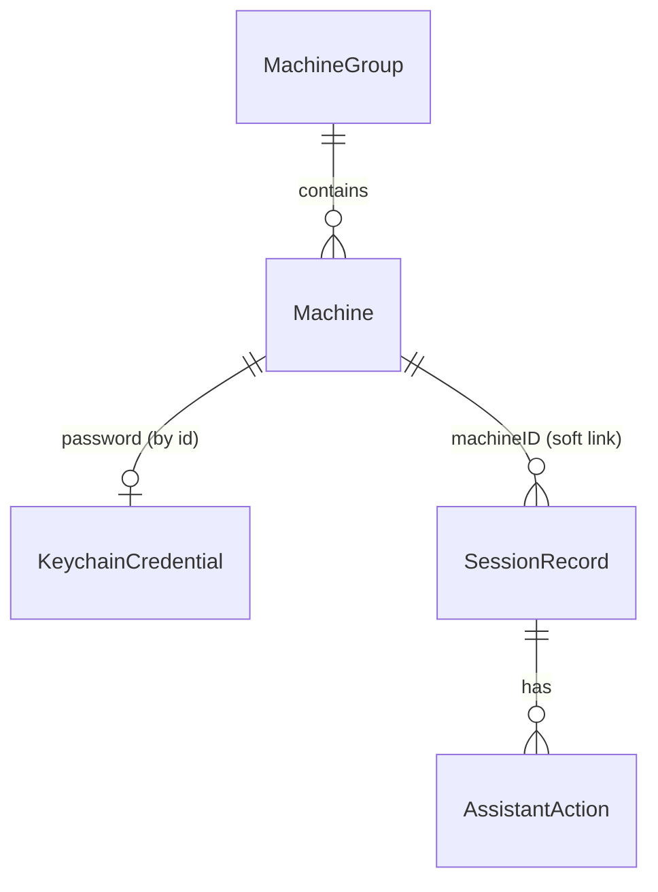

# Backend schema — RemoteDeck

No server: the "backend" is the local SwiftData store, the CloudKit private database (for iCloud Sync) and the macOS Keychain.

## Entities

- **Machine** — a remote endpoint the user can open a session on (Mac ARD, generic VNC, or Anthropic VM).
- **MachineGroup** — a named folder that organizes machines in the sidebar.
- **KeychainCredential** — a secret stored in the macOS Keychain (machine password or Anthropic API key), referenced by account key, never stored in SwiftData.
- **SessionRecord** — one session attempt with its timing and outcome (feeds Session History).
- **AssistantAction** — one action proposed by the Claude Assistant during a session, and the user's decision on it.
- **AppSettings** — app-wide preferences (single record, stored in `UserDefaults`).

## Tables / collections

SwiftData + CloudKit rule: every synced property is optional or has a default, and there are no `@Attribute(.unique)` constraints (uniqueness is enforced in code).

### Machine (SwiftData, synced)

| Field | Type | Required | Default | Notes |
|---|---|---|---|---|
| id | UUID | yes | `UUID()` | Stable id, used in deep links and the Keychain account key |
| name | String | yes | `""` | 1–64 chars |
| kind | String (enum `macARD`, `vnc`, `anthropicVM`) | yes | `macARD` | |
| host | String | yes | `""` | Hostname, IPv4 or IPv6 |
| port | Int | yes | `5900` | 1–65535 |
| username | String? | for `macARD` | nil | |
| group | MachineGroup? | no | nil | Relationship |
| isFavorite | Bool | yes | false | |
| isWatched | Bool | yes | false | Drives Status Notifications (T4.5): probed by `ReachabilityMonitor`; the status itself is not stored |
| scalingMode | String (`fit`, `actual`) | yes | `fit` | |
| sharedClipboard | Bool | yes | true | Starting value of the session's Shared Clipboard toggle (not written back by the toolbar) |
| lastConnectedAt | Date? | no | nil | |
| createdAt | Date | yes | now | |

Indexes: `host`, `name` (SwiftData `#Index`).

When the library runs in memory (on-disk store unusable, `-LibraryDemo`, test host), machine passwords are kept in memory too, so no Keychain item outlives its machine.

Store files (TRD › Backend and database): Machine and MachineGroup in `Application Support/<bundle id>/RemoteDeckLibrary.store`, SessionRecord and AssistantAction in `RemoteDeckHistory.store` next to it.

### MachineGroup (SwiftData, synced)

| Field | Type | Required | Default | Notes |
|---|---|---|---|---|
| id | UUID | yes | `UUID()` | |
| name | String | yes | `""` | 1–40 chars |
| sortOrder | Int | yes | 0 | |
| machines | [Machine]? | no | [] | Inverse relationship, delete rule `.nullify` |

### KeychainCredential (Keychain, generic password items)

| Attribute | Value |
|---|---|
| service | `fr.vincentlauriat.remotedeck` |
| account | `machine.<Machine.id>` or `anthropic.apiKey` |
| data | UTF-8 secret |
| synchronizable | `true` for machine passwords (iCloud Keychain), `false` for the API key. **Local fallback** (Vincent, 2026-10-22): when the synchronizable save of `machine.<id>` fails with -34018 (`errSecMissingEntitlement`, unsigned and ad-hoc builds until T1.2/T4.3), the password is saved as a non-synchronizable item with the same service and account. Reads try the synced item, then the local one; deletes match either flag (`kSecAttrSynchronizableAny`). A synced save removes a stale local copy. T4.3 calls `migrateLocalPasswordsToSynced(machineIDs:)` once the entitlement exists (local → synced, local deleted). |
| accessible | `kSecAttrAccessibleAfterFirstUnlock` |

### SessionRecord (SwiftData, local store only)

| Field | Type | Required | Default | Notes |
|---|---|---|---|---|
| id | UUID | yes | `UUID()` | |
| machineID | UUID | yes | — | Plain id, not a relationship, so history survives cross-store sync |
| machineName | String | yes | — | Snapshot, for deleted machines |
| startedAt | Date | yes | now | |
| connectMillis | Int? | no | nil | Click to first frame |
| endedAt | Date? | no | nil | |
| outcome | String (`connected`, `authFailed`, `unreachable`, `cancelled`, `dropped`) | yes | — | |
| bytesReceived | Int64 | yes | 0 | |
| assistantTokens | Int | yes | 0 | Tokens of the Claude Assistant during this attempt: every response's `input_tokens` + `cache_read_input_tokens` + `cache_creation_input_tokens` + `output_tokens` |

Indexes: `startedAt`, `machineID`.

Lifecycle (T3.5, `SessionModel`): one record per attempt (Connect, Retry, Reconnect, or Save in Edit credentials), in the local store.
- Inserted when the attempt starts, with `startedAt` and outcome `cancelled`, so a run killed while connecting leaves a `cancelled` row.
- First framebuffer update: outcome `connected`, `connectMillis` = time from the start of the attempt (before the Keychain read) to that update, on a monotonic clock; Machine.lastConnectedAt is set too.
- End: `endedAt`, the moment of the click (Disconnect, Cancel, window close) or of ⌘Q, not the end of the network teardown (duration = `endedAt − startedAt`), and `bytesReceived`, filled in once the teardown is over (every byte the server sent on that connection, handshake included: `RFBConnection.bytesReceived`). Disconnect after the first frame keeps `connected`; Cancel or closing before it, `cancelled`; failures map as in AppFlow › Session errors (`authFailed`, `unreachable`; `dropped` after authentication, with `connectMillis` nil if no frame came). ⌘Q sets `endedAt` on every open session (no network teardown), and a window closed just before already has it, whatever the order of the window's `willClose` and `willTerminate`; a killed run leaves `endedAt` nil. A first frame arriving in the same turn as Cancel is ignored (the record stays `cancelled`).
- Interruptions (T5.1, AppFlow › Session Window › Interruptions): a drop after the first frame ends the record `dropped`, and the automatic reconnect that follows is a new record (its own outcome if it fails: `unreachable`, `authFailed`, `dropped`, even though the banner says "Connection lost"). This Mac losing its network path for more than 3 s: a connected record ends `dropped` (also when the re-arm rule shows the banner instead of waiting), an automatic attempt still connecting `cancelled`; a shorter blip leaves the record open. An automatic attempt whose password read would need a Keychain dialog ends `authFailed` (the "password could not be read" banner). Sleep: a connected record keeps `connected` and gets its `endedAt` (as a Disconnect), a connecting one ends `cancelled`; the reconnect after wake is a new record. No record is open while a session waits (reconnect delay, no network, asleep), so the Session History shows no "In progress" row then.
- A failed history save never interrupts the session.

### AssistantAction (SwiftData, local store only)

| Field | Type | Required | Default | Notes |
|---|---|---|---|---|
| id | UUID | yes | `UUID()` | |
| session | SessionRecord | yes | — | Relationship, delete rule `.cascade` from SessionRecord |
| createdAt | Date | yes | now | |
| kind | String (`click`, `doubleClick`, `tripleClick`, `rightClick`, `middleClick`, `drag`, `mouseMove`, `scroll`, `type`, `key`, `holdKey`, `wait`, `screenshot`, `zoom`, `cursorPosition`) | yes | — | One per computer use toolset member the assistant runs (T4.4 added the cases after `screenshot`; stored as the raw String, so no migration) |
| payload | String (JSON) | yes | `"{}"` | `{"input": <the member's input as Claude sent it, screenshot pixels>, "remote": [[x, y], …]}` (remote pixels, when the action has a target). Key combos are in `input`; typed text never is (it may be a password): a `type` stores only `{"input": {"length": <characters>}}` |
| decision | String (`pending`, `confirmed`, `rejected`, `cancelled`, `automatic`) | yes | `pending` | `pending` while the proposal waits; Confirm → `confirmed`, Skip → `rejected`, Stop or disconnect → `cancelled`; `automatic`: a read-only action (screenshot, zoom, cursor position, wait) that ran without asking |

### AppSettings (UserDefaults)

| Key | Type | Default |
|---|---|---|
| `iCloudSyncEnabled` | Bool | false |
| `notificationsEnabled` | Bool | true (Settings › Notifications › Status notifications; off: nothing is posted, probes and dots go on) |
| `defaultSharedClipboard` | Bool | true |
| `claudeModel` | — (not stored) | `claude-opus-5-5`, the constant `ClaudeAPI.defaultModel` (the toolset `computer_toolset_20260801` is the only computer use tool on Opus 5.5). A value left in UserDefaults is ignored. No picker: Settings › Claude shows it |
| `onboardingCompleted` | Bool | false |
| `historyRetentionDays` | Int | 365 |

`onboardingCompleted` is set to true once, when the Onboarding Sheet is finished or skipped ("Later", Esc on the first two pages, or the sheet dismissed with the Library Window); while it is false, each launch shows the sheet, so quitting the app before the sheet ends shows it again. `-LibraryDemo onboarding` shows the sheet whatever the value and never writes it.

## Relations

- MachineGroup 1 — N Machine (optional, `.nullify` on group deletion).
- Machine 1 — 0..1 KeychainCredential, linked by naming convention `machine.<id>`.
- Machine 1 — N SessionRecord, soft link via `machineID` (different stores: synced vs. local).
- SessionRecord 1 — N AssistantAction (`.cascade`).

## Data ownership

Every record belongs to the single local user. Machine and MachineGroup also live in that user's CloudKit **private** database, which only their Apple ID can read.

## Authentication flow

No app sign-up, sign-in, reset or session: single local user. The macOS login and the iCloud account protect the data. Remote-machine authentication happens per session (TRD › Authentication).

## Authorization rules

No accounts and no roles: the single local user has full read/create/update/delete access to **Machine**, **MachineGroup**, **KeychainCredential**, **SessionRecord**, **AssistantAction** and **AppSettings**. This is acceptable because the app runs under one macOS user, its data sits in that user's app container, Keychain and private CloudKit database, and nothing is exposed over the network.

## Data validation

- Machine.name: 1–64 characters, trimmed.
- Machine.host: a valid DNS name (RFC 1123), IPv4 or IPv6 literal; no scheme or path.
- Machine.port: 1–65535.
- Uniqueness: one Machine per lowercase `host:port`. Checked on save; iCloud Sync merges duplicates by keeping the most recently modified one.
- Machine.username: required when `kind == macARD`.
- MachineGroup.name: 1–40 characters, unique case-insensitive.
- Anthropic API key: starts with `sk-ant-` and passes a test request (`GET /v1/models?limit=1`, which bills no tokens) before saving; until then it is a draft in the Settings Window, never written to the Keychain (T4.4).
- AssistantAction coordinates: inside the last screenshot sent to Claude; otherwise the action is answered with an error and never proposed. Inside, they map back to remote pixels per axis and are clamped to the framebuffer (rounding at the last column).

## Retention and deletion

- Deleting a Machine also deletes its KeychainCredential. Its SessionRecords are kept (name snapshot). The Machine is deleted first; if the Keychain delete then fails, the Machine stays deleted and the Library Window shows a warning with the Keychain status (never silent).
- Saving a Machine writes its password to the Keychain **before** SwiftData. -34018 is not a refusal: the password goes to the local fallback item (see KeychainCredential) and the editor notes "Password stored on this Mac only until iCloud Keychain is available". Any other Keychain error saves nothing and shows the error under the password field ("could not be saved", or "could not be removed" when a cleared password fails to delete). If SwiftData then fails, the previous password state is restored (set back or deleted). An unchanged password makes no Keychain call; a cleared one deletes the item, except when the stored password could not be read (then an empty field means "unchanged").
- SessionRecord older than `historyRetentionDays` (365) is purged at launch; AssistantAction older than 30 days too *(assumption: the durations)*. Built in T4.6 (`HistoryRetention.purge`, RemoteDeckCore): at each launch on the on-disk store only (never under the hosted tests or a `-LibraryDemo` mode, both in memory), cutoffs `now − days × 86 400 s`, a row exactly at the cutoff kept, records deleted one by one so their actions go with them (`.cascade`), a setting below 1 read as 1 day. A failed save rolls the context back before the error is rethrown (the pending deletes must not ride along with the next session-record save); the purge is retried at the next launch. No daily run: the app is relaunched often enough for a 30-day bound.
- Screenshots and framebuffer contents are never persisted.
- Export: Session History as CSV (T4.6, `HistoryCSV`): RFC 4180 (header row, CRLF, a field with a comma, quote, CR or LF quoted, quotes doubled), UTF-8, every record oldest first, columns `machine_name, machine_id, started_at, ended_at, connect_ms, duration_ms, outcome, bytes_received, assistant_tokens`; dates ISO 8601 UTC with milliseconds, numbers unformatted, outcomes as stored except for a record with no end and no first frame (stored `cancelled` at insertion), written `connecting` while its session is open and `interrupted` otherwise, an empty field for no value (no first frame, no end). The machine's host and user are not exported (privacy; SessionRecord does not hold them), nor any AssistantAction. The machine name (it can come from a Bonjour service name through the Discovery prefill) is escaped against spreadsheet formulas, OWASP-style: a leading `'` when it starts with `=`, `+`, `-`, `@`, tab or CR, then the RFC 4180 quoting. The Machine Library is exported/imported as JSON, without passwords. *(assumption)*
- GDPR: personal data stays on the user's devices and their iCloud account. Screenshots sent to Anthropic follow Anthropic's API data policy.

## Migrations and seed data

- No seed data: the library starts empty, and the Onboarding Sheet leads to the Discovery Panel.
- Schema changes use a SwiftData `VersionedSchema` + `SchemaMigrationPlan`. CloudKit schema changes are additive only (no renames or deletions of synced fields); deploy the CloudKit schema to production before shipping a release that uses new fields.
