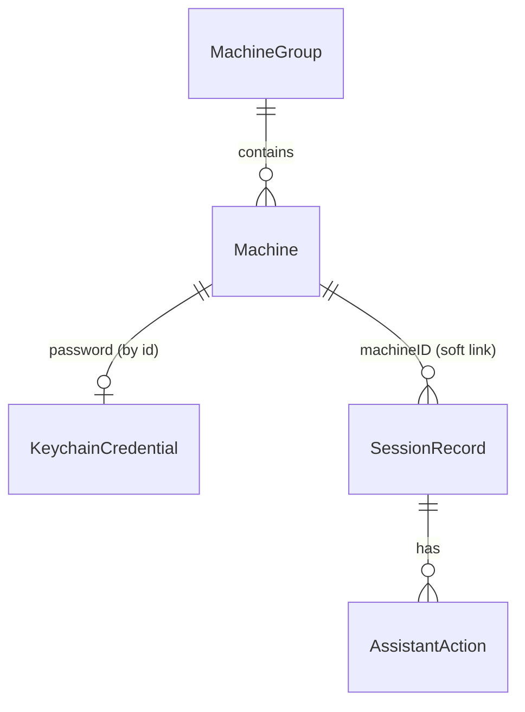

# Backend schema — RemoteDeck

No server: the "backend" is the local SwiftData store, the CloudKit private database (for iCloud Sync) and the macOS Keychain.

## Entities

- **Machine** — a remote endpoint the user can open a session on (Mac ARD, generic VNC, or Anthropic VM).
- **MachineGroup** — a named folder that organizes machines in the sidebar.
- **KeychainCredential** — a secret stored in the macOS Keychain (machine password or Anthropic API key), referenced by account key, never stored in SwiftData.
- **SessionRecord** — one session attempt with its timing and outcome (feeds Session History).
- **AssistantAction** — one action proposed by the Claude Assistant during a session, and the user's decision on it.
- **AppSettings** — app-wide preferences (single record, stored in `UserDefaults`).

## Tables / collections

SwiftData + CloudKit rule: every synced property is optional or has a default, and there are no `@Attribute(.unique)` constraints (uniqueness is enforced in code).

### Machine (SwiftData, synced)

| Field | Type | Required | Default | Notes |
|---|---|---|---|---|
| id | UUID | yes | `UUID()` | Stable id, used in deep links and the Keychain account key |
| name | String | yes | `""` | 1–64 chars |
| kind | String (enum `macARD`, `vnc`, `anthropicVM`) | yes | `macARD` | |
| host | String | yes | `""` | Hostname, IPv4 or IPv6 |
| port | Int | yes | `5900` | 1–65535 |
| username | String? | for `macARD` | nil | |
| group | MachineGroup? | no | nil | Relationship |
| isFavorite | Bool | yes | false | |
| isWatched | Bool | yes | false | Drives Status Notifications |
| scalingMode | String (`fit`, `actual`) | yes | `fit` | |
| sharedClipboard | Bool | yes | true | |
| lastConnectedAt | Date? | no | nil | |
| createdAt | Date | yes | now | |

Indexes: `host`, `name` (SwiftData `#Index`).

### MachineGroup (SwiftData, synced)

| Field | Type | Required | Default | Notes |
|---|---|---|---|---|
| id | UUID | yes | `UUID()` | |
| name | String | yes | `""` | 1–40 chars |
| sortOrder | Int | yes | 0 | |
| machines | [Machine]? | no | [] | Inverse relationship, delete rule `.nullify` |

### KeychainCredential (Keychain, generic password items)

| Attribute | Value |
|---|---|
| service | `fr.vincentlauriat.remotedeck` |
| account | `machine.<Machine.id>` or `anthropic.apiKey` |
| data | UTF-8 secret |
| synchronizable | `true` for machine passwords (iCloud Keychain), `false` for the API key |
| accessible | `kSecAttrAccessibleAfterFirstUnlock` |

### SessionRecord (SwiftData, local store only)

| Field | Type | Required | Default | Notes |
|---|---|---|---|---|
| id | UUID | yes | `UUID()` | |
| machineID | UUID | yes | — | Plain id, not a relationship, so history survives cross-store sync |
| machineName | String | yes | — | Snapshot, for deleted machines |
| startedAt | Date | yes | now | |
| connectMillis | Int? | no | nil | Click to first frame |
| endedAt | Date? | no | nil | |
| outcome | String (`connected`, `authFailed`, `unreachable`, `cancelled`, `dropped`) | yes | — | |
| bytesReceived | Int64 | yes | 0 | |
| assistantTokens | Int | yes | 0 | Input + output tokens of the Claude Assistant |

Indexes: `startedAt`, `machineID`.

### AssistantAction (SwiftData, local store only)

| Field | Type | Required | Default | Notes |
|---|---|---|---|---|
| id | UUID | yes | `UUID()` | |
| session | SessionRecord | yes | — | Relationship, delete rule `.cascade` from SessionRecord |
| createdAt | Date | yes | now | |
| kind | String (`click`, `doubleClick`, `type`, `key`, `scroll`, `screenshot`) | yes | — | |
| payload | String (JSON) | yes | `"{}"` | Coordinates, text, key combo |
| decision | String (`pending`, `confirmed`, `rejected`, `cancelled`) | yes | `pending` | |

### AppSettings (UserDefaults)

| Key | Type | Default |
|---|---|---|
| `iCloudSyncEnabled` | Bool | false |
| `notificationsEnabled` | Bool | true |
| `defaultSharedClipboard` | Bool | true |
| `claudeModel` | String | `claude-sonnet-5-5` *(assumption)* |
| `onboardingCompleted` | Bool | false |
| `historyRetentionDays` | Int | 365 |

## Relations

- MachineGroup 1 — N Machine (optional, `.nullify` on group deletion).
- Machine 1 — 0..1 KeychainCredential, linked by naming convention `machine.<id>`.
- Machine 1 — N SessionRecord, soft link via `machineID` (different stores: synced vs. local).
- SessionRecord 1 — N AssistantAction (`.cascade`).

## Data ownership

Every record belongs to the single local user. Machine and MachineGroup also live in that user's CloudKit **private** database, which only their Apple ID can read.

## Authentication flow

No app sign-up, sign-in, reset or session: single local user. The macOS login and the iCloud account protect the data. Remote-machine authentication happens per session (TRD › Authentication).

## Authorization rules

No accounts and no roles: the single local user has full read/create/update/delete access to **Machine**, **MachineGroup**, **KeychainCredential**, **SessionRecord**, **AssistantAction** and **AppSettings**. This is acceptable because the app runs under one macOS user, its data sits in that user's app container, Keychain and private CloudKit database, and nothing is exposed over the network.

## Data validation

- Machine.name: 1–64 characters, trimmed.
- Machine.host: a valid DNS name (RFC 1123), IPv4 or IPv6 literal; no scheme or path.
- Machine.port: 1–65535.
- Uniqueness: one Machine per lowercase `host:port`. Checked on save; iCloud Sync merges duplicates by keeping the most recently modified one.
- Machine.username: required when `kind == macARD`.
- MachineGroup.name: 1–40 characters, unique case-insensitive.
- Anthropic API key: starts with `sk-ant-` and passes a test request before saving.
- AssistantAction coordinates: inside the current framebuffer bounds; otherwise the action is rejected.

## Retention and deletion

- Deleting a Machine also deletes its KeychainCredential. Its SessionRecords are kept (name snapshot).
- SessionRecord older than `historyRetentionDays` (365) is purged at launch. AssistantAction older than 30 days is purged. *(assumption)*
- Screenshots and framebuffer contents are never persisted.
- Export: Session History as CSV. The Machine Library is exported/imported as JSON, without passwords. *(assumption)*
- GDPR: personal data stays on the user's devices and their iCloud account. Screenshots sent to Anthropic follow Anthropic's API data policy.

## Migrations and seed data

- No seed data: the library starts empty, and the Onboarding Sheet leads to the Discovery Panel.
- Schema changes use a SwiftData `VersionedSchema` + `SchemaMigrationPlan`. CloudKit schema changes are additive only (no renames or deletions of synced fields); deploy the CloudKit schema to production before shipping a release that uses new fields.
