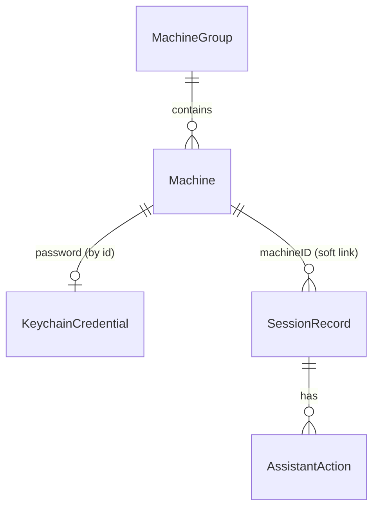

# Backend schema — RemoteDeck

No server: the "backend" is the local SwiftData store, the CloudKit private database (for iCloud Sync) and the macOS Keychain.

## Entities

- **Machine** — a remote endpoint the user can open a session on (Mac ARD, generic VNC, Anthropic VM, or, post-1.0, SSH).
- **MachineGroup** — a named folder that organizes machines in the sidebar.
- **KeychainCredential** — a secret stored in the macOS Keychain (machine password, Anthropic API key, and, post-1.0, an SSH private key or its passphrase), referenced by account key, never stored in SwiftData.
- **PortForward** *(post-1.0)* — one saved local port forward of an SSH machine; not an entity of its own: a `Codable` value encoded in `Machine.portForwardsData`.
- **SessionRecord** — one session attempt with its timing and outcome (feeds Session History).
- **AssistantAction** — one action proposed by the Claude Assistant during a session, and the user's decision on it.
- **AppSettings** — app-wide preferences (single record, stored in `UserDefaults`).

## Tables / collections

SwiftData + CloudKit rule: every synced property is optional or has a default, and there are no `@Attribute(.unique)` constraints (uniqueness is enforced in code).

### Machine (SwiftData, synced)

| Field | Type | Required | Default | Notes |
|---|---|---|---|---|
| id | UUID | yes | `UUID()` | Stable id, used in deep links and the Keychain account key |
| name | String | yes | `""` | 1–64 chars |
| kind | String (enum `macARD`, `vnc`, `anthropicVM`, `ssh`) | yes | `macARD` | `ssh` is schema V3 (post-1.0), raw value `"ssh"`. An unknown raw value still decodes as `.macARD` (`MachineKind(rawValue:) ?? .macARD`): v1.0.0 would show an SSH machine as a Mac (Migrations) |
| host | String | yes | `""` | Hostname, IPv4 or IPv6 |
| port | Int | yes | `5900` (`22` for `ssh`: `MachineKind.defaultPort`) | 1–65535 |
| username | String? | for `macARD` and `ssh` | nil | |
| group | MachineGroup? | no | nil | Relationship |
| isFavorite | Bool | yes | false | |
| isWatched | Bool | yes | false | Drives Status Notifications (T4.5): probed by `ReachabilityMonitor`; the status itself is not stored |
| scalingMode | String (`fit`, `actual`) | yes | `fit` | |
| sharedClipboard | Bool | yes | true | Starting value of the session's Shared Clipboard toggle (not written back by the toolbar). The Machine Editor proposes `defaultSharedClipboard` for a new machine, and false for an Anthropic VM (T5.3); a session whose address is on the public Internet starts with it off |
| lastConnectedAt | Date? | no | nil | |
| createdAt | Date | yes | now | |
| modifiedAt | Date? | no | nil | Schema V2 (T4.3): set by every Machine Editor save, on any Mac; in the iCloud Sync merge the survivor takes the fields of the most recently modified copy. nil for a machine not edited since V1 |
| sshAuthMethod | String? (`SSHAuthMethod`: `password`, `keyInSSHFolder`, `importedKey`) | no (`ssh` machines) | nil | Schema V3 (post-1.0). Computed `sshAuth: SSHAuthMethod` reads nil or an unknown value as `.password` |
| sshKeyFileName | String? | for `keyInSSHFolder` | nil | Schema V3. Path relative to `~/.ssh` (e.g. `id_ed25519`), never absolute; non-empty and without `/..` |
| portForwardsData | Data? | no | nil | Schema V3. JSON array of `PortForward`; computed `portForwards: [PortForward]` reads nil or invalid data as `[]` (representation is the builder's choice within the CloudKit rules; plan Task 7 chose an encoded field over a separate model) |

Indexes: `host`, `name` (SwiftData `#Index`).

When the library runs in memory (on-disk store unusable, `-LibraryDemo`, test host), machine passwords are kept in memory too, so no Keychain item outlives its machine.

Store files (TRD › Backend and database): Machine and MachineGroup in `Application Support/<bundle id>/RemoteDeckLibrary.store`, SessionRecord and AssistantAction in `RemoteDeckHistory.store` next to it.

### MachineGroup (SwiftData, synced)

| Field | Type | Required | Default | Notes |
|---|---|---|---|---|
| id | UUID | yes | `UUID()` | |
| name | String | yes | `""` | 1–40 chars |
| sortOrder | Int | yes | 0 | |
| machines | [Machine]? | no | [] | Inverse relationship, delete rule `.nullify` |

### PortForward (value type inside `Machine.portForwardsData`, synced with the machine; post-1.0)

| Field | Type | Required | Default | Notes |
|---|---|---|---|---|
| id | UUID | yes | `UUID()` | `Identifiable`; keys the run-time `ForwardState` |
| label | String? | no | nil | Shown in the toolbar menu instead of `localhost:8080 → localhost:80` |
| localPort | Int | yes | — | 1024–65535; listens on `127.0.0.1` and `::1` only; unique within the machine |
| remoteHost | String | yes | `"localhost"` | Resolved on the server side (default: the machine itself) |
| remotePort | Int | yes | — | 1–65535 |

Local (`-L`) forwards only. The run-time state (`starting`, `active`, `failed(SSHError)`, `stopped`) is not stored.

### KeychainCredential (Keychain, generic password items)

| Attribute | Value |
|---|---|
| service | `fr.vincentlauriat.remotedeck`; Debug builds `fr.vincentlauriat.remotedeck.dev` (T4.3 review: Debug and Release share the keychain access group, and the Debug app must never read or write the Release app's items). At launch the entitled Debug app moves its own machines' items from the shared service and copies the API key (left in place: it may be the Release app's) |
| account | `machine.<Machine.id>`, `anthropic.apiKey`, and, post-1.0, `sshKey.<Machine.id>`, `sshPassphrase.<Machine.id>`, `sshLocalPassphrase.<Machine.id>` (SSH secrets below) |
| data | UTF-8 secret (for `sshKey.<id>`, the OpenSSH private key text) |
| synchronizable | `true` for machine passwords (iCloud Keychain), `false` for the API key. **Local fallback** (Vincent, 2026-10-22): when the synchronizable save of `machine.<id>` fails with -34018 (`errSecMissingEntitlement`, unsigned and ad-hoc builds until T1.2/T4.3), the password is saved as a non-synchronizable item with the same service and account. Reads try the synced item, then the local one; deletes match either flag (`kSecAttrSynchronizableAny`). A synced save removes a stale local copy. Since T4.3 the app calls `migrateLocalPasswordsToSynced(machineIDs:)` after every launch of the on-disk library: local → synced, the local item deleted only once the synced copy reads back equal; a synced item that already exists is kept (it may be newer, from another Mac) and the local copy deleted. Keychain access group (T4.3): `KFLACS69T9.fr.vincentlauriat.remotedeck`, the same for the Debug and Release apps. |
| accessible | Synchronizable items `kSecAttrAccessibleAfterFirstUnlock`; local items (the API key, the machine-password fallback) `kSecAttrAccessibleAfterFirstUnlockThisDeviceOnly` (T5.3), set at each save. macOS honours it only for synchronizable or data-protection-keychain items: the file-keychain local items of an unentitled build carry it without effect. Since T4.3 the entitled app keeps every item in the data-protection keychain (`kSecUseDataProtectionKeychain`), where the attribute applies; items an older build left in the file keychain are still read (fallback) and moved at launch (written, read back, then deleted from the file keychain). An ad-hoc or unsigned build (CI) keeps the file keychain |
| SSH secrets (post-1.0) | `KeychainAccount.sshPrivateKey(UUID)` = `sshKey.<id>`: an imported private key, synchronizable. `.sshKeyPassphrase(UUID)` = `sshPassphrase.<id>`: the passphrase of an imported key ("Remember in Keychain"), synchronizable. `.sshLocalKeyPassphrase(UUID)` = `sshLocalPassphrase.<id>`: the passphrase of a key used in place from `~/.ssh`, local to this Mac (`kSecAttrAccessibleAfterFirstUnlockThisDeviceOnly`). The password of a `password` SSH machine is the machine's ordinary `machine.<id>` item. Same `-34018` local fallback and launch migration (local → synced, read back before delete) as machine passwords. A key used in place is never copied to the Keychain: only the file name is stored (`Machine.sshKeyFileName`) |

### SessionRecord (SwiftData, local store only)

| Field | Type | Required | Default | Notes |
|---|---|---|---|---|
| id | UUID | yes | `UUID()` | |
| machineID | UUID | yes | — | Plain id, not a relationship, so history survives cross-store sync |
| machineName | String | yes | — | Snapshot, for deleted machines |
| startedAt | Date | yes | now | |
| connectMillis | Int? | no | nil | Click to first frame |
| endedAt | Date? | no | nil | |
| outcome | String (`connected`, `authFailed`, `unreachable`, `cancelled`, `dropped`, and, post-1.0, `hostKeyRejected`) | yes | — | `hostKeyRejected` (additive raw value in the local store, not synced): the host key was refused before authentication. Per plan Task 9 it is the outcome of the user declining an unknown key; for a *changed* key the design left `authFailed` or a new outcome to the builder and the plan does not say (open). SSH sessions are recorded like screen sessions; `connectMillis` is the time to the first event that makes the session "connected" (open: the design and plan do not define the SSH "first frame"); `bytesReceived` for SSH is not specified |
| bytesReceived | Int64 | yes | 0 | |
| assistantTokens | Int | yes | 0 | Tokens of the Claude Assistant during this attempt: every response's `input_tokens` + `cache_read_input_tokens` + `cache_creation_input_tokens` + `output_tokens` |

Indexes: `startedAt`, `machineID`.

Lifecycle (T3.5, `SessionModel`): one record per attempt (Connect, Retry, Reconnect, or Save in Edit credentials), in the local store.
- Inserted when the attempt starts, with `startedAt` and outcome `cancelled`, so a run killed while connecting leaves a `cancelled` row.
- First framebuffer update: outcome `connected`, `connectMillis` = time from the start of the attempt (before the Keychain read) to that update, on a monotonic clock; Machine.lastConnectedAt is set too.
- End: `endedAt`, the moment of the click (Disconnect, Cancel, window close) or of ⌘Q, not the end of the network teardown (duration = `endedAt − startedAt`), and `bytesReceived`, filled in once the teardown is over (every byte the server sent on that connection, handshake included: `RFBConnection.bytesReceived`). Disconnect after the first frame keeps `connected`; Cancel or closing before it, `cancelled`; failures map as in AppFlow › Session errors (`authFailed`, `unreachable`; `dropped` after authentication, with `connectMillis` nil if no frame came). ⌘Q sets `endedAt` on every open session (no network teardown), and a window closed just before already has it, whatever the order of the window's `willClose` and `willTerminate`; a killed run leaves `endedAt` nil. A first frame arriving in the same turn as Cancel is ignored (the record stays `cancelled`).
- Interruptions (T5.1, AppFlow › Session Window › Interruptions): a drop after the first frame ends the record `dropped`, and the automatic reconnect that follows is a new record (its own outcome if it fails: `unreachable`, `authFailed`, `dropped`, even though the banner says "Connection lost"). This Mac losing its network path for more than 3 s: a connected record ends `dropped` (also when the re-arm rule shows the banner instead of waiting), an automatic attempt still connecting `cancelled`; a shorter blip leaves the record open. An automatic attempt whose password read would need a Keychain dialog ends `authFailed` (the "password could not be read" banner). Sleep: a connected record keeps `connected` and gets its `endedAt` (as a Disconnect), a connecting one ends `cancelled`; the reconnect after wake is a new record. No record is open while a session waits (reconnect delay, no network, asleep), so the Session History shows no "In progress" row then.
- A failed history save never interrupts the session.

### AssistantAction (SwiftData, local store only)

| Field | Type | Required | Default | Notes |
|---|---|---|---|---|
| id | UUID | yes | `UUID()` | |
| session | SessionRecord | yes | — | Relationship, delete rule `.cascade` from SessionRecord |
| createdAt | Date | yes | now | |
| kind | String (`click`, `doubleClick`, `tripleClick`, `rightClick`, `middleClick`, `drag`, `mouseMove`, `scroll`, `type`, `key`, `holdKey`, `wait`, `screenshot`, `zoom`, `cursorPosition`) | yes | — | One per computer use toolset member the assistant runs (T4.4 added the cases after `screenshot`; stored as the raw String, so no migration) |
| payload | String (JSON) | yes | `"{}"` | `{"input": <the member's input as Claude sent it, screenshot pixels>, "remote": [[x, y], …]}` (remote pixels, when the action has a target). Key combos are in `input`; typed text never is (it may be a password): a `type` stores only `{"input": {"length": <characters>}}` |
| decision | String (`pending`, `confirmed`, `rejected`, `cancelled`, `automatic`) | yes | `pending` | `pending` while the proposal waits; Confirm → `confirmed`, Skip → `rejected`, Stop or disconnect → `cancelled`; `automatic`: a read-only action (screenshot, zoom, cursor position, wait) that ran without asking |

### AppSettings (UserDefaults)

| Key | Type | Default |
|---|---|---|
| `iCloudSyncEnabled` | Bool | false (T4.3: Settings › iCloud Sync, or "Enable" on the Onboarding Sheet; read when the Library store opens, so a change applies at the next launch) |
| `notificationsEnabled` | Bool | true (Settings › Notifications › Status notifications; off: nothing is posted, probes and dots go on) |
| `defaultSharedClipboard` | Bool | true |
| `claudeModel` | — (not stored) | `claude-opus-5-5`, the constant `ClaudeAPI.defaultModel` (the toolset `computer_toolset_20260801` is the only computer use tool on Opus 5.5). A value left in UserDefaults is ignored. No picker: Settings › Claude shows it |
| `onboardingCompleted` | Bool | false |
| `historyRetentionDays` | Int | 365 |
| `terminalOptionAsMeta` | Bool | false (post-1.0: Settings › Terminal › "Use ⌥ as Meta"; off as in Ghostty so AZERTY ⌥ characters keep working) |
| `terminalFontSize` | Double | 13, Ghostty's default on macOS (T7.1 report); ⌘+ / ⌘− in a terminal tab or the Settings › Terminal stepper, kept within 8…36 |
| `sshFolderBookmark` | Data | absent (post-1.0: the app-scoped security-scoped bookmark of the user's `~/.ssh` folder, made when the user grants it; per Mac, never synced; a stale bookmark reads as not granted) |
| `trustedHostKeys` | `[String: [String: String]]` | empty (post-1.0: `["host:port": ["algorithm": "SHA256 fingerprint"]]`, host lowercased, algorithm = the key type (`rsa-sha2-256/512` stored as `ssh-rsa`), the host keys the user trusted on this Mac, and those `~/.ssh/known_hosts` matched (pinned); read entry by entry, a malformed value is dropped alone; per Mac, never synced; entries of a deleted machine are removed) |
| `publicInternetConfirmed.<Machine.id>` | String | absent (T5.3: "Connect anyway" on the "Unencrypted connection over the Internet" sheet stores the host it was confirmed for, trimmed and lowercased; a different host counts as unconfirmed; per Mac, not synced; removed when the machine is deleted) |

`onboardingCompleted` is set to true once, when the Onboarding Sheet is finished or skipped ("Later", Esc on the first two pages, or the sheet dismissed with the Library Window); while it is false, each launch shows the sheet, so quitting the app before the sheet ends shows it again. `-LibraryDemo onboarding` shows the sheet whatever the value and never writes it.

## Relations

- MachineGroup 1 — N Machine (optional, `.nullify` on group deletion).
- Machine 1 — 0..1 KeychainCredential, linked by naming convention `machine.<id>`; an SSH machine adds up to three more by `sshKey.<id>`, `sshPassphrase.<id>`, `sshLocalPassphrase.<id>` (post-1.0).
- Machine 1 — N SessionRecord, soft link via `machineID` (different stores: synced vs. local).
- SessionRecord 1 — N AssistantAction (`.cascade`).

## Data ownership

Every record belongs to the single local user. Machine and MachineGroup also live in that user's CloudKit **private** database, which only their Apple ID can read.

## Authentication flow

No app sign-up, sign-in, reset or session: single local user. The macOS login and the iCloud account protect the data. Remote-machine authentication happens per session (TRD › Authentication).

## Authorization rules

No accounts and no roles: the single local user has full read/create/update/delete access to **Machine**, **MachineGroup**, **KeychainCredential**, **SessionRecord**, **AssistantAction** and **AppSettings**. This is acceptable because the app runs under one macOS user, its data sits in that user's app container, Keychain and private CloudKit database, and nothing is exposed over the network.

## Data validation

- Machine.name: 1–64 characters, trimmed.
- Machine.host: a valid DNS name (RFC 1123), IPv4 or IPv6 literal; no scheme or path.
- Machine.port: 1–65535.
- Uniqueness: one Machine per lowercase `host:port`. Checked on save; iCloud Sync merges duplicates (T4.3, `LibraryDeduplication` in RemoteDeckCore, applied by the app's `LibraryMerger` at launch, after every CloudKit import and when the app becomes active): the survivor is elected from fields that never change (the first created, then the smaller id), so two Macs whose snapshots differ in `modifiedAt` still keep the same machine (an order on a mutable field could make each delete the other's copy and its synced password; review of T4.3). "Most recently modified wins" applies to the content: when the dropped copy that goes has a newer `modifiedAt`, the survivor takes its user-visible fields (name, kind, host, port, user name, group, favorite, watch, scaling, shared clipboard, `modifiedAt`, and since V3 `sshAuthMethod`, `sshKeyFileName`, `portForwardsData`); `lastConnectedAt` keeps the later one. The merge runs only after CloudKit's setup (or a finished import), after an import, when the app becomes active, and never while a mirroring event runs. Passwords: the survivor keeps its own; if it has none on this Mac, the dropped one's is copied to it and read back; the dropped machines' items are deleted only after the model is saved. For SSH machines (post-1.0) the dropped copy's `sshKey.<id>` and `sshPassphrase.<id>` items are copied to the survivor the same way (read back before delete), as one pair: a survivor with its own key keeps its own pair. `sshLocalPassphrase.<id>` (local by design) is never copied; the dropped machine's three SSH items are deleted after the save. A machine whose password cannot be read without a dialog, whose copy fails, or that has an open session on this Mac waits for a later merge.
- MachineGroup names that collide (trimmed, case-insensitive) after a sync fold into the group with the smaller id (`sortOrder` can differ between Macs); their machines move to it.
- Machine.username: required when `kind == macARD` or `ssh`.
- SSH machines (post-1.0, `MachineValidator`, new `Reason` cases `missingKeyFile`, `invalidForwardPort`, `duplicateLocalPort`): user name required; `keyInSSHFolder` requires a non-empty `sshKeyFileName` without `/..`; each `PortForward`: local port in 1024–65535, remote port in 1–65535; local ports unique within the machine. No public-address rule (SSH is encrypted). The `host:port` uniqueness key is unchanged, so the Azure VM reached over two addresses is two machines.
- MachineGroup.name: 1–40 characters, unique case-insensitive.
- Anthropic API key: starts with `sk-ant-` and passes a test request (`GET /v1/models?limit=1`, which bills no tokens) before saving; until then it is a draft in the Settings Window, never written to the Keychain (T4.4).
- AssistantAction coordinates: inside the last screenshot sent to Claude; otherwise the action is answered with an error and never proposed. Inside, they map back to remote pixels per axis and are clamped to the framebuffer (rounding at the last column).

## Retention and deletion

- Deleting a Machine also deletes its KeychainCredential. For an SSH machine (post-1.0) that includes `sshKey.<id>`, `sshPassphrase.<id>` and `sshLocalPassphrase.<id>`, and its trusted host keys (`trustedHostKeys` entry for its `host:port`) on this Mac; the `sshFolderBookmark` stays (it is not per machine). Its SessionRecords are kept (name snapshot). The Machine is deleted first; if the Keychain delete then fails, the Machine stays deleted and the Library Window shows a warning with the Keychain status (never silent).
- Saving an SSH machine with an imported key writes `sshKey.<id>` (and the passphrase if remembered) to the Keychain **before** SwiftData, like a password; the key text is never in the store and is kept in memory only until Save. Saving a machine with another host or port removes its old `trustedHostKeys` entry, unless another machine still has that `host:port` (a new address asks once). Switching an SSH machine away from the imported key removes `sshKey.<id>` and `sshPassphrase.<id>`; away from its key in `~/.ssh` (or to another file), `sshLocalPassphrase.<id>`; a newly imported key not remembered with a passphrase removes the previous `sshPassphrase.<id>`.
- Saving a Machine writes its password to the Keychain **before** SwiftData. -34018 is not a refusal: the password goes to the local fallback item (see KeychainCredential) and the editor notes "Password stored on this Mac only until iCloud Keychain is available". Any other Keychain error saves nothing and shows the error under the password field ("could not be saved", or "could not be removed" when a cleared password fails to delete). If SwiftData then fails, the previous password state is restored (set back or deleted). An unchanged password makes no Keychain call; a cleared one deletes the item, except when the stored password could not be read (then an empty field means "unchanged").
- SessionRecord older than `historyRetentionDays` (365) is purged at launch; AssistantAction older than 30 days too *(assumption: the durations)*. Built in T4.6 (`HistoryRetention.purge`, RemoteDeckCore): at each launch on the on-disk store only (never under the hosted tests or a `-LibraryDemo` mode, both in memory), cutoffs `now − days × 86 400 s`, a row exactly at the cutoff kept, records deleted one by one so their actions go with them (`.cascade`), a setting below 1 read as 1 day. A failed save rolls the context back before the error is rethrown (the pending deletes must not ride along with the next session-record save); the purge is retried at the next launch. No daily run: the app is relaunched often enough for a 30-day bound.
- Screenshots and framebuffer contents are never persisted.
- Export: Session History as CSV (T4.6, `HistoryCSV`): RFC 4180 (header row, CRLF, a field with a comma, quote, CR or LF quoted, quotes doubled), UTF-8, every record oldest first, columns `machine_name, machine_id, started_at, ended_at, connect_ms, duration_ms, outcome, bytes_received, assistant_tokens`; dates ISO 8601 UTC with milliseconds, numbers unformatted, outcomes as stored except for a record with no end and no first frame (stored `cancelled` at insertion), written `connecting` while its session is open and `interrupted` otherwise, an empty field for no value (no first frame, no end). The machine's host and user are not exported (privacy; SessionRecord does not hold them), nor any AssistantAction. The machine name (it can come from a Bonjour service name through the Discovery prefill) is escaped against spreadsheet formulas, OWASP-style: a leading `'` when it starts with `=`, `+`, `-`, `@`, tab or CR, then the RFC 4180 quoting. The Machine Library is exported/imported as JSON, without passwords. *(assumption)*
- GDPR: personal data stays on the user's devices and their iCloud account. Screenshots sent to Anthropic follow Anthropic's API data policy.

## Migrations and seed data

- No seed data: the library starts empty, and the Onboarding Sheet leads to the Discovery Panel.
- Schema changes use a SwiftData `VersionedSchema` + `SchemaMigrationPlan`. V1 (frozen, `RemoteDeckSchemaV1`) → V2 (`Machine.modifiedAt`, T4.3) is a lightweight stage, tested on an on-disk V1 store. CloudKit schema changes are additive only (no renames or deletions of synced fields); deploy the CloudKit schema to production before shipping a release that uses new fields.
- **V2 → V3 (post-1.0, `RemoteDeckSchemaV3`, SSH machines):** a lightweight stage, tested on an on-disk V2 store (existing machines keep their fields, the new ones are nil). V3 adds `Machine.sshAuthMethod`, `sshKeyFileName` and `portForwardsData` (all optional) and the `ssh` kind value; V1 and V2 stay frozen. `SyncSchemaTests` extends its rule (no synced property required without a default) to V3. **The CloudKit schema must be deployed to Production before the release that ships V3** (ImplementationPlan › T7.14; `release.sh` needs `CLOUDKIT_SCHEMA_DEPLOYED=1`). `SessionOutcome.hostKeyRejected` is a new raw value in the local store (no migration). Older clients: v1.0.0 decodes an unknown `kind` as `.macARD`, so a Mac still on 1.0.0 would show an SSH machine as a Mac and an edit there could sync a wrong kind back; Vincent (2026-11-08) chose no code guard because every Mac updates through Sparkle, and the release notes say to update every Mac before adding SSH machines.
