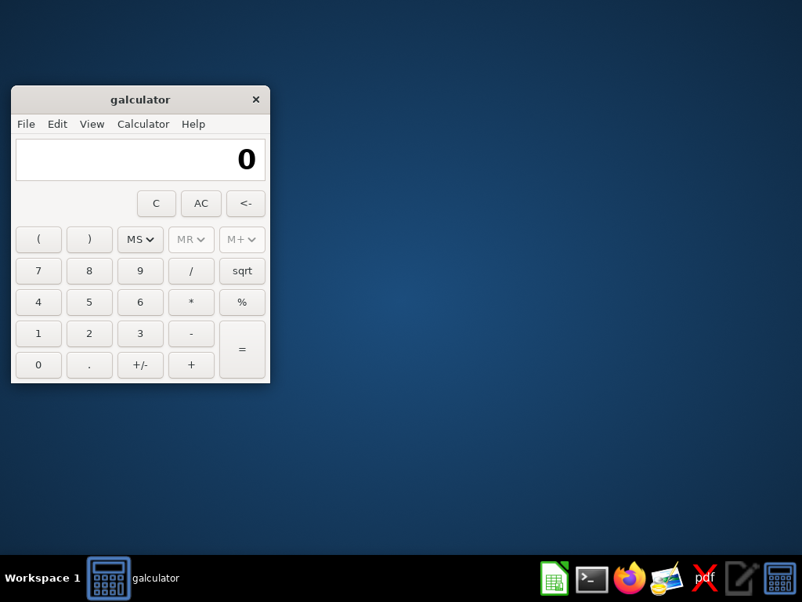
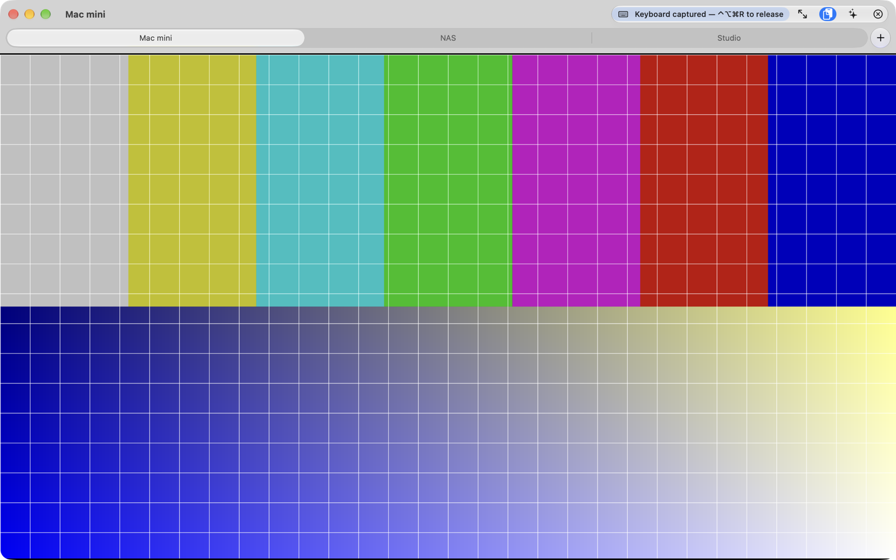
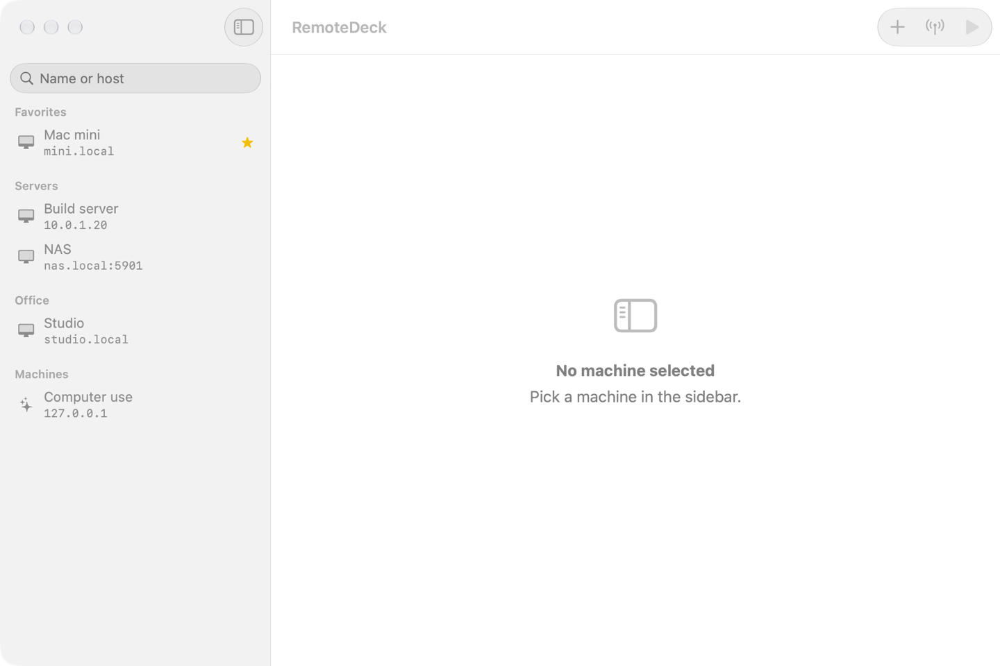

<div align="center">

# RemoteDeck

**A native macOS client for every remote screen you use.**

Macs over Apple Remote Desktop / Screen Sharing, VNC desktops and Anthropic computer use environments, from one window, with saved credentials, tabs, and an optional Claude Assistant that acts on the remote screen one confirmed action at a time.

[](https://www.apple.com/macos)
[](https://github.com/vincentlauriat/RemoteDeck/releases/latest)
[](https://swift.org)
[](LICENSE)

</div>

---



*A real frame from Anthropic's computer use reference container, decoded by RFBKit. Below: a Session Window with three tabs in the Debug demo mode (synthetic test pattern).*



## Why

Reaching a remote Mac usually means juggling Apple Remote Desktop (heavy, built for fleet management) and the built-in Screen Sharing app (no machine library, no tabs), and Anthropic computer use desktops need yet another VNC client or a browser page. RemoteDeck is one fast, keyboard-friendly app for all of them: a Machine Library with credentials in the Keychain, sessions in tabs, Bonjour discovery on the LAN, and nothing of ARD's fleet management.

It is a native SwiftUI + AppKit app with its own RFB/VNC protocol library (Apple Diffie-Hellman authentication, Raw, CopyRect, ZRLE and Tight decoding) and a Metal-backed framebuffer, sandboxed and notarized.

## Features

| | |
| --- | --- |
| 🗂️ **Machine Library** | Every remote machine in one sidebar: groups, favorites, search, passwords in the Keychain |
| 🖥️ **Screen Session** | View and control a remote Mac (ARD, Apple Diffie-Hellman auth) or a VNC desktop; Raw, CopyRect, ZRLE and Tight decoding, Metal rendering |
| 📡 **Bonjour Discovery** | Find Macs with Screen Sharing or Remote Management on the LAN without typing an address |
| 🤖 **Anthropic VM Connect** | Open a Claude computer use environment (VNC endpoint) like any other machine |
| 🗃️ **Session Tabs** | Several sessions as tabs of one window, `⌘1`…`⌘9` |
| ⌨️ **Keyboard capture** | Key combos go to the remote; `⌃⌥⌘R` releases them; ⌘Tab, ⌘Space and other system shortcuts too, with Accessibility access |
| 📋 **Shared Clipboard** | Text both ways, Extended Clipboard (UTF-8) when the server supports it; off for a session over the Internet until you turn it on |
| ☁️ **iCloud Sync** | The same Machine Library on all your Macs; passwords through iCloud Keychain |
| ✨ **Claude Assistant** | Ask Claude about the remote screen or give it a task, with your own API key; every action waits for your Confirm |
| 🔔 **Status Notifications** | A notification when a watched machine goes offline or comes back |
| 📊 **Session History** | Local log of sessions with a 30-day summary and CSV export; a Menu Bar Extra for quick connect |
| 🔁 **Session resilience** | One automatic reconnect after a drop, a clean stop before sleep and a reconnect after wake |
| 🔒 **Safe by default** | App Sandbox, Hardened Runtime, a warning before any unencrypted connection over the Internet, Apple authentication required for Macs with a user name |
| 📖 **In-app Help & What's New** | Help (`⌘?`) and *What's New…* read this README and the release notes live from GitHub and render them natively (no web view) |
| 🚀 **Updates** | Sparkle 2, EdDSA-signed, from this repository's GitHub Releases |



## Install

Download the latest `RemoteDeck-<version>.dmg` from the [GitHub Releases page](https://github.com/vincentlauriat/RemoteDeck/releases/latest), open it and drag **RemoteDeck** to **Applications**. The first public release is not out yet (see the roadmap).

Requires **macOS 15 Sequoia or later**. The DMG is signed with an Apple Developer ID, built with the Hardened Runtime and sandboxed, then notarized and stapled by Apple: it opens with a double-click, without a Gatekeeper warning, even offline. After that, **RemoteDeck › Check for Updates…** (Sparkle) installs new versions; it also checks once a day.

First launch:

- **Local Network.** macOS asks whether RemoteDeck may find devices on your local network. Allow it to use Bonjour Discovery and to reach machines on your LAN (System Settings › Privacy & Security › Local Network, if you said no).
- **Accessibility (optional).** To send system shortcuts such as ⌘Tab or ⌘Space to the remote Mac instead of your own, grant Accessibility to RemoteDeck (System Settings › Privacy & Security › Accessibility). Without it, sessions work and those shortcuts stay local.
- **Notifications (optional).** Asked only when you click "Allow notifications", for watched machines going offline or coming back.
- **iCloud.** Machine Library sync uses your iCloud account; turn it on in onboarding or in Settings › iCloud.

RFB is not encrypted beyond the Apple authentication exchange: use RemoteDeck on your LAN or through a VPN. A connection that reaches a public Internet address stops first and asks.

## Quick start (build from source)

**Requirements:** macOS 15 or later, Xcode (stable release) and [XcodeGen](https://github.com/yonaskolb/XcodeGen).

```bash
brew install xcodegen
git clone https://github.com/vincentlauriat/RemoteDeck.git
cd RemoteDeck
xcodegen generate
xcodebuild -project RemoteDeck.xcodeproj -scheme RemoteDeck -derivedDataPath build/DerivedData CODE_SIGNING_ALLOWED=NO build
open "build/DerivedData/Build/Products/Debug/RemoteDeck Dev.app" --args -LibraryDemo session
```

`-LibraryDemo session` runs the Debug app on an in-memory sample library with fake sessions: no network, no Keychain. An unsigned build has no iCloud Sync (the keychain falls back to local items); the signed build uses Xcode automatic signing on the maintainer's team.

## Architecture

```
┌────────────────────────────────────────────────────────────┐
│                RemoteDeck.app (SwiftUI + AppKit)           │
│  Library Window · Session Window (tabs) · Discovery Panel  │
│  Claude Assistant Panel · Session History · Settings · Help│
│  FramebufferView (CAMetalLayer) · SessionInputController   │
└───────┬───────────────────┬───────────────────┬────────────┘
        │                   │                   │
┌───────▼────────┐  ┌───────▼─────────┐  ┌──────▼───────────┐
│ RFBKit         │  │ RemoteDeckCore  │  │ ClaudeKit        │
│ RFB/VNC over   │  │ SwiftData models│  │ Messages API     │
│ NWConnection,  │  │ (CloudKit sync),│  │ client (raw HTTP,│
│ ARD/VNC auth,  │  │ Keychain store, │  │ ephemeral        │
│ decoders,      │  │ validation,     │  │ session), compu- │
│ input, clip-   │  │ Session History │  │ ter use toolset  │
│ board          │  │                 │  │                  │
└────────────────┘  └─────────────────┘  └──────────────────┘
```

| Layer | Choice | Reason |
| --- | --- | --- |
| Language | Swift 6 (strict concurrency) | Native macOS; data races are build errors |
| UI | SwiftUI windows and sheets, AppKit `NSView` + `CAMetalLayer` for the framebuffer | Native look, Metal rendering and full input capture |
| Protocol | `RFBKit`, a local package over `Network.framework` | Own, UI-free implementation: Apple Diffie-Hellman auth, Tight/ZRLE, parsers fuzzed against hostile servers |
| Data | SwiftData, Machine Library mirrored to CloudKit (private database) | iCloud Sync without a server |
| Secrets | Keychain only (machine passwords synchronizable, API key local) | Never in SwiftData, logs or CloudKit |
| Claude | `ClaudeKit`, raw HTTP to the Messages API | No Anthropic Swift SDK exists |
| Updates | [Sparkle](https://sparkle-project.org) 2.10.0 | EdDSA-signed updates from GitHub Releases |
| Project file | [XcodeGen](https://github.com/yonaskolb/XcodeGen) | YAML source of truth, no `.pbxproj` merge pain |

The specs live next to the code: [PRD](PRD.md), [TRD](TRD.md), [AppFlow](AppFlow.md), [DesignBrief](DesignBrief.md), [BackendSchema](BackendSchema.md) and [ImplementationPlan](ImplementationPlan.md).

## Project layout

```
RemoteDeck/
├── project.yml                 # XcodeGen spec (source of truth)
├── appcast.xml                 # Sparkle feed (one item per release, written by release.sh)
├── RemoteDeck/                 # app target
│   ├── RemoteDeckApp.swift     # @main: scenes, menus, dependency wiring
│   ├── Library/ Views/         # Library Window, Machine Editor, Settings, Help windows…
│   ├── Session/                # Session Window, tabs, framebuffer, input, clipboard
│   ├── Discovery/ Reachability/ History/ Sync/ Onboarding/ Assistant/ Updates/
│   ├── Help/                   # Help & What's New: GitHub fetch, Markdown block splitter
│   ├── Localization/           # fr + en strings
│   └── Assets.xcassets/        # AppIcon (generated by Scripts/make-icon.swift)
├── Packages/
│   ├── RFBKit/                 # RFB/VNC protocol, no UI (+ the rfb-probe tool)
│   ├── RemoteDeckCore/         # SwiftData models, Keychain store, validation
│   └── ClaudeKit/              # Claude Assistant protocol side
├── RemoteDeckTests/            # hosted app tests (fakes only: no network, Keychain or pasteboard)
├── Scripts/
│   ├── release.sh              # archive → Developer ID export → DMG → notarize → staple → appcast
│   ├── dmg-settings.py         # dmgbuild layout (hash-pinned venv)
│   ├── make-icon.swift         # draws the AppIcon set
│   ├── make-dmg-background.swift # draws the DMG background
│   └── prepublic-check.sh      # gitleaks + history checks before going public
├── docs/                       # GitHub Pages landing page (index.html, assets/)
└── release/                    # DMGs + release notes (local, git-ignored)
```

## Development

```bash
xcodegen generate                                   # after editing project.yml or adding files
xcodebuild -project RemoteDeck.xcodeproj -scheme RemoteDeck -derivedDataPath build/DerivedData -allowProvisioningUpdates build
xcodebuild -project RemoteDeck.xcodeproj -scheme RemoteDeck -derivedDataPath build/DerivedData-unsigned CODE_SIGNING_ALLOWED=NO test   # all four suites
cd Packages/RFBKit && swift test                    # protocol (fastest loop)
cd Packages/RemoteDeckCore && swift test            # models, Keychain, validation
cd Packages/ClaudeKit && swift test                 # Claude Assistant (fake HTTP only)
./Scripts/make-icon.swift all                       # redraw the AppIcon set
./Scripts/release.sh --dry-run 0.1.0                # every release step up to notarization
```

The Debug app also has demo modes for screenshots and manual checks, `-LibraryDemo list | session | history | help | whats-new | …` (see [CLAUDE.md](CLAUDE.md)). CI on GitHub Actions is manual only (`workflow_dispatch`): pull requests merge on the four suites passing locally.

Releases (maintainer): bump `MARKETING_VERSION` and `CURRENT_PROJECT_VERSION` in `project.yml`, write `release/release-notes-<version>.md`, then `CLOUDKIT_SCHEMA_DEPLOYED=1 ./Scripts/release.sh <version>`; it prints the `gh release create` command and the pages to update.

## Roadmap

- [x] **Framing** — PRD, TRD, AppFlow, DesignBrief, BackendSchema, ImplementationPlan
- [x] **Step 1 — project setup** (live test hosts pending)
- [x] **Step 2 — data and authentication** — SwiftData models, Keychain, ARD and VNC auth
- [x] **Step 3 — main path (P0)** — Machine Library, Screen Session, Bonjour Discovery, Anthropic VM Connect
- [x] **Step 4 — secondary features (P1)** — clipboard, tabs, iCloud Sync, Claude Assistant, notifications, history (live two-Mac sync check pending)
- [ ] **Step 5 — quality** — resilience, security review and parser fuzzing done; accessibility pass (T5.2) and 4K performance (T5.4) pending
- [ ] **Step 6 — go-live** — release pipeline, landing page and in-app Help ready; clean-Mac test run, CloudKit Production schema and first release pending
- [ ] **File Transfer** (P2)

## Contributing

This is a personal project, but issues and pull requests are welcome. Read [CLAUDE.md](CLAUDE.md) and the spec documents first: feature, screen and entity names are shared verbatim across them. Every change keeps the four test suites green and never lets a test reach a real host, the Keychain, the pasteboard or the Anthropic API.

## License

MIT — see [LICENSE](LICENSE).
