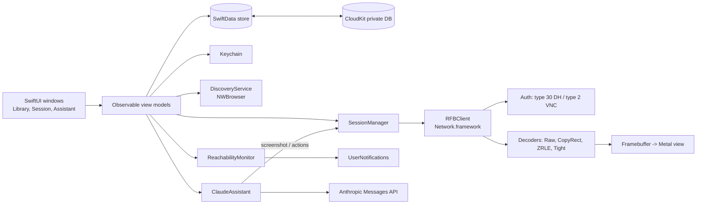

# TRD — RemoteDeck

## Platforms

- macOS 15 Sequoia and later, Apple Silicon and Intel (universal binary). *(assumption)*
- Built with the stable Xcode release (never a beta), Swift 6 language mode.

## Frontend and hosting

- **UI:** SwiftUI for windows, sidebar, sheets and settings; AppKit (`NSView` subclass backed by a `CAMetalLayer`) for the remote framebuffer view, because it needs precise key, mouse, scroll-wheel and modifier handling that SwiftUI does not expose.
- **App type:** regular windowed app plus a `MenuBarExtra` for quick connect.
- **Distribution:** Developer ID-signed, notarized DMG in `release/`, Sparkle auto-updates (see the `macos-app-release` skill). *(assumption)*
- **No hosted component.**

## Backend and database

- **No server.**
- **Local store:** SwiftData (SQLite) in the app container, two files under `Application Support/<bundle id>/`: `RemoteDeckLibrary.store` (Machine, MachineGroup; the store CloudKit will sync) and `RemoteDeckHistory.store` (SessionRecord, AssistantAction). The bundle-id folder keeps the Debug (`….dev`) and Release stores apart even when the app runs unsandboxed (CI builds with `CODE_SIGNING_ALLOWED=NO`). Under XCTest (`XCTestConfigurationFilePath` / `XCTestSessionIdentifier` / `XCTestBundlePath` in the environment) the app opens an in-memory container, so the hosted tests never touch the user's store. If the on-disk store cannot be opened, the Library Window runs on an empty in-memory store and says that changes will not be saved.
- **Sync:** SwiftData's CloudKit integration, private database of Vincent's iCloud account (container `iCloud.<bundle-id>`). Only the Machine Library is synced: Machine and MachineGroup. Session History, Assistant Actions and settings stay local.
- **Secrets:** macOS Keychain. Machine passwords are synchronizable items (iCloud Keychain); the Anthropic API key is a local-only item. Until the build has the iCloud Keychain entitlement (T1.2/T4.3), a machine password refused with -34018 is stored as a local item instead (BackendSchema › KeychainCredential), and T4.3 migrates those to synced.

## Authentication and roles

No app accounts and no roles: single local user (see PRD). Remote authentication is per machine:
- **ARD / macOS Screen Sharing:** RFB security type 30 (Apple Diffie-Hellman, macOS user name + password).
- **VNC:** security type 2 (VNC password) and type 1 (none), for Anthropic VMs and generic VNC servers. An empty password is no password: type 2 is chosen only with a password, type 1 otherwise; a type-2-only server with no password fails with `credentialsRequired` ("This server needs a password" + Edit credentials).
- **Anthropic API:** API key entered in Settings Window, stored in Keychain.

## External services and APIs

| Provider | Usage | Limits / quotas | Credential owner |
|---|---|---|---|
| Remote Macs (RFB/ARD, TCP 5900) | Screen Session | LAN or VPN only | Vincent (macOS accounts on each Mac) |
| Anthropic computer use environments (VNC, TCP 5900 by default) | Anthropic VM Connect. Reference container ([anthropic-quickstarts/computer-use-demo](https://github.com/anthropics/anthropic-quickstarts/tree/main/computer-use-demo), read 2026-10-23): Ubuntu 22.04, Xvfb `:1` at 1024 × 768 × 24, mutter + tint2, `x11vnc -display $DISPLAY -forever -shared -wait 50 -rfbport 5900 -nopw` ([`image/x11vnc_startup.sh`](https://github.com/anthropics/anthropic-quickstarts/blob/main/computer-use-demo/image/x11vnc_startup.sh)), so no VNC password: security type 1 expected (*inferred from `-nopw`, to confirm with `rfb-probe`*). Ports 5900 (VNC), 6080 (noVNC), 8501 (Streamlit), 8080 (combined UI). `ANTHROPIC_API_KEY` is passed to the container, but `image/entrypoint.sh` never checks it. The scripts suggest the desktop starts without it; this is not observed, since the container was not run. The agent loop needs the key. Image `ghcr.io/anthropics/anthropic-quickstarts:computer-use-demo-latest`, about 1.2 GB compressed (index digest `sha256:b608f419…`, arm64 1.16 GB / amd64 1.20 GB, layer sizes summed from the GHCR manifests on 2026-10-23). How to run it: `Packages/RFBKit/Tests/RFBKitTests/Captures/README.md`. | Reachable endpoint required (local Docker or tunnel). The README publishes `-p 5900:5900` on every interface with an unauthenticated VNC: bind it to `127.0.0.1` | Vincent |
| Anthropic Messages API (computer use tool) | Claude Assistant | Per-account rate limits and token billing; screenshots ≈ 1–2k tokens each *(assumption)* | Vincent (API key) |
| Apple CloudKit (private DB) | iCloud Sync | Free private-database quota, counted against Vincent's iCloud storage | Vincent (iCloud account) |
| Apple Bonjour (`_rfb._tcp`, `_net-assistant._udp`) | Bonjour Discovery: one `NWBrowser` per type while the Discovery Panel is open; each service resolved with `DNSServiceResolve` (SRV target `<name>.local` and port, no connection to the host); results merged per host. `_net-assistant._udp` is the ARD agent (port 3283), never the RFB port: a host advertising only it gets 5900. Kind guess: Remote Management advertised → Mac ARD, else VNC (an `_rfb._tcp` record carries no TXT telling Apple's server apart, measured 2026-10-22). | LAN multicast only; needs the Local Network privilege (macOS 15+, TN3179) | — |
| macOS User Notifications | Status Notifications | — | — |
| Sparkle appcast (GitHub Releases) | Updates | — | Vincent |

## Architecture

- **RFBClient** is a Swift package target (`RFBKit`) with no UI dependency, so it can be unit-tested against recorded byte streams.
- Each session runs its socket and decoding on its own actor; frames go to the main actor only as dirty rectangles for the Metal texture.
- **FramebufferView** (`RemoteDeck/Session/`): each update's regions are copied into a staging `MTLBuffer` and blitted into a private `bgra8Unorm` texture (RFBKit's pixel layout), ordered on the GPU so an upload never tears a frame in flight nor waits on the GPU. A display link draws only when something changed and pauses otherwise, so a static desktop costs no frames. The shader is compiled from source at run time, so the build does not depend on Xcode's optional Metal toolchain component.
- **Input** (`InputTranslator` in RFBKit, `SessionInputController` in the app): see Input below.
- **Session Tabs (T4.2)** (`RemoteDeck/Session/SessionTabs.swift`): every session is a native macOS window tab of one Session Window. A native tab *is* an `NSWindow` in a tab group, so each tab keeps its own `WindowGroup(for: UUID.self)` window, `SessionWindowView`, `SessionModel`, `FramebufferView` and connection; nothing is shared between tabs but the tab bar.
  - **Why an AppKit bridge.** SwiftUI has no tabbing API on macOS: the macOS 27.0 SDK's `SwiftUI.swiftinterface` has no `tabbing` symbol (grep, 2026-10-23), and SwiftUI gives its windows the identifier `SwiftUI-WindowGroup-session` with `tabbingMode = .automatic` (logged in the demo), which tabs them only when the user's "Prefer tabs" setting says so. AppKit's API is old and stable: `NSWindow.tabbingMode`, `tabbingIdentifier`, `addTabbedWindow(_:ordered:)` (macOS 10.12) and `tabGroup` / `NSWindowTabGroup.insertWindow(_:at:)` / `selectedWindow` (10.13), per `AppKit.framework/Headers/NSWindow.h` and `NSWindowTabGroup.h`, so nothing needs Swift 6.4 or a recent SDK.
  - **How.** When a session window gets its content, `SessionWindowAccessor` sets the shared `tabbingIdentifier` and `tabbingMode = .preferred` at once (`SessionTabs.prepare`, so AppKit treats it as a session tab before SwiftUI orders it in where possible), then hands it to `SessionTabs.adopt` on the next main-queue turn (after SwiftUI set it up), which inserts it into the tab group of the frontmost session window in `NSApp.orderedWindows` that is visible and not minimised, else of the session window opened last. Only a window's first attachment is tabbed: if SwiftUI re-attaches the accessor (a tab the user moved to its own window), it is left where it is. A window that closed before its deferred `adopt` ran is ignored (`forget` keeps a weak list of closed windows), so it can never be registered again nor host the next tab. Several Connects in one turn: SwiftUI does not create their windows in call order (the demo's Mac mini, NAS, Studio came up NAS, Studio, Mac mini), so each tab goes before the first tab of a later Connect (`SessionModel.openOrder`, `SessionTabs.insertionIndex`). Connect on a machine whose tab is open selects that tab (`SessionTabs.select`: `tabGroup.selectedWindow`, then `makeKeyAndOrderFront`). The tab bar's "+" (AppKit shows it, SwiftUI answers with a window without a value) closes that empty window one main-queue turn after it appears (not inside AppKit's handling of the click) and brings the Library Window forward; hiding the "+" would need a custom `NSWindow` class or swizzling `newWindowForTab:` out of SwiftUI's responder chain. Moving a tab to its own window or merging windows (Window menu) is AppKit's; the next session joins the frontmost group. Deep links (not built yet) will open through the same scene, so in a new tab.
  - **Close signal.** A session ends only on `NSWindow.willCloseNotification` of its own window (`SessionWindowObserver`): close button, the tab's close button, ⌘W with the keyboard released, Disconnect and Cancel (`dismissWindow`). Switching tabs (the other tabs' windows are ordered out), minimising, full screen, and moving or merging tabs keep the same `NSWindow` open, so they never close a session. The closing window also leaves the `SessionTabs` registry (`forget`), so a Connect after the last tab closed opens a fresh window instead of a tab of the closed one. An observer detached from its window (SwiftUI rebuilt the content) stops observing it; the observer then in the window reports its close. SwiftUI's `onDisappear` (the T3.5 signal) is no longer used; `onAppear` returns early when the window already holds its session, so a re-run on a re-shown tab can never take it for a duplicate.
  - **⌘1…⌘9.** Window › Session Tabs › Tab 1…9 (menu items, `SessionTabCommands`), plus the session view itself, which matches the key code (`LocalShortcut`) in its local monitor, captured or not, and selects the tab: AZERTY's top row gives `&é"'(§è!ç` even with ⌘ (`UCKeyTranslate` on `com.apple.keylayout.French`, 2026-10-23), so a menu item for "1" alone might not match there. Both may run for one key press; selecting a tab twice is harmless. The tab is the one at that index in the key session window's group, else in the frontmost visible session window's group, else in the last opened one's.
  - **Per tab.** Only the selected tab's window can be key, and capture, the system-shortcut tap and the clipboard poll all follow the view's window key state already (`FramebufferView.updateFocus`, `onWindowKeyChange`): selecting another tab resigns key on the one left, which releases everything held there (`InputTranslator.releaseAll`), removes its tap and stops its clipboard poll; the new tab's window becomes key and its view captures (no modifier is pressed on that remote by the switch).
  - **Background tabs.** `FramebufferView` observes `NSWindow.didChangeOcclusionStateNotification`; while `occlusionState` lacks `.visible` (unselected tab, minimised, fully covered) the display link stays paused whatever is owed (`FramebufferRedrawState.isVisible`), and showing it again owes one frame. The connection keeps running: updates are taken from the event sequence (so the next one is requested as usual, same back-pressure), copied and blitted into the texture, so the tab shows the current picture as soon as it is selected. Cost of a background tab: the decode and the blit, no draw.
- **ClaudeAssistant** turns API `tool_use` actions (click, type, key, scroll) into RFB pointer and key events, but only after the user confirms each one.

## Input

- **Keyboard capture.** While the Session Window's framebuffer view is first responder of the key window, a local `NSEvent` monitor (in-app, no permission) takes every keyDown/keyUp/flagsChanged before AppKit dispatches it, so ⌘ shortcuts go to the remote instead of the local menus. Losing focus (another window, another app) pauses the capture and releasing it (⌃⌥⌘R, matched on key code `kVK_ANSI_R` + exactly ⌃⌥⌘, so any layout) ends it; both send a release for every key, modifier and mouse button held on the remote (keys, then modifiers last-pressed first, then buttons). Focus coming back resumes a paused capture; after a release, a click in the view captures again.
- **Local shortcuts while captured:** ⌘1…⌘9 only (`LocalShortcut`, RFBKit: top-row digit key codes + exactly ⌘, so AZERTY's ⌘& ⌘é… match). The key-down and its key-up go back to AppKit (menus, `performKeyEquivalent`); everything else, ⌘W/⌘Q/⌘K/⌘V included, goes to the remote. Extend the allow-list in `LocalShortcut`.
- **System shortcuts** (`SystemShortcut`, RFBKit), which macOS takes before the frontmost app: ⌘Tab/⌘⇧Tab (Dock app switcher), ⌘Space/⌥⌘Space (Spotlight, Finder search), ⌃Space/⌃⌥Space (input sources), ⌃↑/⌃↓/⌃←/⌃→ and their ⇧ variants (Mission Control, App Exposé, Spaces), ⌘⇧3/4/5 and ⌃⌘⇧3/4 (screenshots), ⌥⌘D (Dock hiding). The list follows Apple's "Mac keyboard shortcuts" article (support.apple.com/102650: ⌘Tab, ⌘Space, ⌥⌘Space, ⌃Space, ⌘⇧3/4/5, ⌃↑, ⌃↓, ⌥⌘D) and the `com.apple.symbolichotkeys` entries read on the dev Mac (ids 28–35, 52, 64–65, 79–82 enabled; ⌃←/⌃→ and the ⇧/⌃ variants come from there only). ⌃Space/⌃⌥Space (ids 60–61) were disabled on that Mac; they are taken anyway, harmless where macOS would not act and needed where several input sources are on. Left local on purpose: Force Quit (the way out if RemoteDeck hangs, which would also stall the tap until macOS times it out), F-key hotkeys (the top row sends media keys by default), and ⌘`, ⌘⇧/, ⌃⌘Q, ⌃⌘Space, which reach the app and so already go to the remote.
- **System-shortcut tap** (`SystemShortcutTap`, owned by `FramebufferView`). A `CGEvent.tapCreate(.cgSessionEventTap, .headInsertEventTap, .defaultTap)` for keyDown/keyUp, created only while the keyboard is captured, the session window is key and `AXIsProcessTrusted()` is true (`SystemShortcutTapState`, pure and unit-tested), and invalidated at once on release, focus loss, window close and `tearDownInput`. After `tapDisabledByTimeout`/`tapDisabledByUserInput`, the state is re-evaluated on the next main-queue turn (so a pending didResignKey is handled first and a stale "window key" never re-enables the tap over another app), with a fresh trust check: re-enabled if still wanted, removed otherwise. A failed `tapCreate` is not retried until the next capture start or a trust change. The real tap sits behind `EventTapHandle` (`MachEventTap`), so tests drive install, removal and system disables with a fake. Its run-loop source is on the main run loop, so the callback runs on the main thread: it reads the event into a Sendable `KeyInput` and, through `MainActor.assumeIsolated`, asks `SessionInputController.handleSystemKey`. That takes a `SystemShortcut` key-down plus its repeats and key-up (by key code, since ⌘ may be up before Tab) and swallows them; everything else, flagsChanged included, passes through to the local monitor, so each event is handled once. Two invariants make the callback safe: the source lives on the main run loop (so `assumeIsolated` holds), and the owner outlives the tap (`install` retains the `SystemShortcutTap` for the refcon, `remove` releases it only after invalidating the port). The refcon crosses into the main-actor closure as an address (`UInt`), the event as a Sendable `KeyInput`.
- **Revoking access while the tap is active** can hang system input: Apple bug FB24619068 (forums thread 844416) and thread 735204. Mitigation: while a tap exists, the `com.apple.accessibility.api` distributed notification triggers a trust re-check (at once and again 0.5 s later, as the new value may not read back yet) and the tap is removed as soon as trust is gone. Unverified live.
- **Accessibility permission.** Checked with `AXIsProcessTrusted()` at every capture or focus change, never prompted at launch; the first capture start without trust in an app run shows `AXIsProcessTrustedWithOptions` with the prompt, once. Untrusted, or `tapCreate` failing, leaves everything as before (local monitor only) and `FramebufferView.systemShortcutsAvailable` false, for T3.5's toolbar notice; `SystemShortcutTap.openAccessibilitySettings()` opens `x-apple.systempreferences:com.apple.preference.security?Privacy_Accessibility`. The Debug `-FramebufferDebug` stderr line ends with `tap=none|enabled|disabled trusted=… system-shortcuts=available|unavailable`.
- **App Sandbox and the tap.** Apple DTS: the PostEvent and ListenEvent privileges "*are* compatible with the App Sandbox", while the APIs gated by the Accessibility privilege are not; System Settings shows PostEvent *and* Accessibility under the same Accessibility pane (forums thread 820594, Mar 2026; thread 780626, Apr 2025: "It *is* possible for a sandboxed app to use the Input Monitoring privilege… I'm using the `CGEventTap` API"). A user report (thread 122492, 2021) says a `.defaultTap` triggers the Accessibility request, a `.listenOnly` one the Input Monitoring request. Local probe (2026-10-21, macOS 27.2): an ad-hoc-signed, sandboxed bundle created a `.defaultTap` keyboard tap when trust came from its responsible process (launched from an already trusted parent process), and reported untrusted when launched on its own (`open`; `tapCreate` not attempted, to avoid a prompt). So the sandbox does not block the tap itself; what is unverified is RemoteDeck receiving the grant under its own identity. If `AXIsProcessTrusted` stays false for the sandboxed app after the user enables it, switch the check/prompt to `CGPreflightPostEventAccess`/`CGRequestPostEventAccess` (the PostEvent privilege, documented as sandbox-compatible) before considering a non-sandboxed build; the sandbox stays on (Vincent's decision).
- **Keysyms.** Keys that type no character (arrows, F1–F20, Return, keypad, Delete/Forward Delete…) map from the key code (TigerVNC's macOS table). Other keys send the keysym of the character the local layout typed, so an AZERTY keyboard types `a`, `é`, `@` correctly (characters typed with ⌥, such as `{` `}` `[` `]` `|` `~` on AZERTY, go out with the Option keysym still held: unverified on both hosts, an X11 app may see Alt+`{`); with ⌘ or ⌃ held, the character with Shift only (⌘C is Command + `c`). Dead keys compose locally and the composed character is sent. Caps Lock is a press + release per toggle, and characters are sent with their case applied. Input methods (CJK) are not supported while captured.
- **Deliberate divergences from TigerVNC** (which translates every printable key with Shift, ⌥ and Caps Lock through UCKeyTranslate and sends dead keys as `dead_*` keysyms): with ⌘ or ⌃ held we use `charactersIgnoringModifiers`, which also drops ⌥ (⌘⌥C is ⌘⌥ + `c`, not ⌘⌥ + `ç`); dead keys compose locally instead of being sent; and other ⌘ combos on AZERTY digit-row keys (⌘⇧, ⌘⌥ + the `&`/`1` key…) are sent with the key's character. ⌘ + the top-row digit keys alone (⌘1…⌘9) never reach the remote: they are the local tab-switching allow-list.
- **Modifier sync, both ways.** Every key and pointer event carries the local modifier flags: a held modifier whose flag is gone is released, and a set flag whose modifier is not held is pressed first (left key unless the device bits say right). This covers ⌘ already down when the capture starts (⌘V still sends ⌘), Shift-click with the keyboard released, and a profile change (released under the old keysyms, pressed again under the new ones).
- **⌘ and ⌥ per machine kind** (`ModifierProfile`). Mac ARD: ⌘ → `Alt_L/R`, ⌥ → `Meta_L/R` (OSXvnc's server table, which its author says Apple's server shares; noVNC sends a Mac's ⌘ as `Alt_L` for the same reason). VNC / Anthropic VM (X11): ⌘ → `Super_L/R`, ⌥ → `Alt_L/R` (TigerVNC's macOS viewer). Unverified on the macOS 26 server: check ⌘C/⌘V on the test Mac with the Debug `-FramebufferDebug static -InputDebug ard|x11` log.
- **Pointer.** Buttons left/middle/right = mask bits 1/2/4. ⌃-click is sent as Control + left click, not converted to a right click. Moves over the letterbox are ignored; while a button is held, positions clamp to the framebuffer edge. The content's right and bottom edges map to the last pixel. Moves that pile up while a write is in flight collapse to the latest; key events and button transitions are never merged or reordered (`InputSender`).
- **Orphan key-ups across tabs (T4.2).** ⌘2 selects tab 2 on its key-down; the 2's key-up and the ⌘ release then land on tab 2's view, which captures from then on. `SessionInputController` sends a key-up only for a key-down it sent in the current capture (`pressedKeys`), and syncs no modifier from any other, so tab 2's remote sees nothing (T3.3b review: it used to see ⌘ pressed and released). Accepted: moving the pointer over the new tab while ⌘ is still held syncs ⌘ from the pointer event's flags (pointer events carry modifiers, so a ⌘-click works), so that remote sees ⌘ down then up when it is let go, which is what a held ⌘ means there.
- **Teardown order (T3.5).** When a session view goes away, `FramebufferView.tearDownInput()` (called on leaving the window and from `dismantleNSView`) removes the key monitor and the system-shortcut tap and emits the release of everything held; only then call `InputSender.finish()`, then close the connection, so the releases reach the server. `SessionModel` runs it for every stop: window closed (Disconnect, Cancel, close button) → `tearDownInput()`; error with the window kept → `releaseCapture()` (the key monitor stays, so Reconnect captures again, and the view gives up the focus so Esc reaches a Reconnect overlay's Cancel); then `finish()`, `await stopped()` bounded to 2 s (a frozen peer cannot keep the socket and tasks alive; closing ends its stuck write), `close()`. Both release calls always send `InputTranslator.releaseAll()` (idempotent), so a button held after ⌃⌥⌘R (pointer events flow outside the capture) is released too. The close signal is the window's (tab's) `willClose` since T4.2 (Architecture › Session Tabs). A window close first runs `SessionModel.beginClose()` synchronously (later results of the attempt ignored, record ended at the click), then the teardown in a task; the `open` runs in its own task, the only one holding the credentials, dropped when it ends. The event loop is never cancelled before `close()`: ending the `RFBSessionEvents` sequence closes the socket at once and the releases would be lost. Unit-tested with a fake connection whose sends are slow (`SessionModelTests`).
- **Session wiring (T3.5).** `SessionModel` builds the `InputSender` from `SessionConnection.send` after `startSession`, routes the view's `onInput` to it, sets the modifier profile from the machine kind (Mac ARD → `.appleRemoteDesktop`, VNC and Anthropic VM → `.x11`), and makes the view first responder only at the first frame: before it, the keyboard stays local so Esc reaches the overlay's Cancel. `open` uses a 10 s timeout (connect + handshake), longer than the Test's 5 s, so a slow VPN still connects; the ≤ 5 s target is measured in Session History, not enforced. The events are consumed as returned (never re-buffered), so taking an update still requests the next.
- **Scroll.** Buttons 4/5 (vertical) and 6/7 (horizontal), one press + release per step. AppKit's scrolling deltas already include the natural-scrolling setting, so they are used as is. Deltas accumulate: trackpad deltas at 50 pt per step (noVNC's `WHEEL_STEP`), wheel deltas at one line per step (an accelerated wheel's 0.1-line events add up); a new trackpad gesture (phase `.began`) drops the leftover; at most 10 steps per event.

## Clipboard

- **Protocol** (`ClipboardNegotiation`, `ExtendedClipboard`, RFBKit). Legacy ClientCutText/ServerCutText (RFC 6143 §7.5.6, §7.6.4: ISO 8859-1, LF line ends, U32 length). Characters outside Latin-1 are sent as `?` (TigerVNC's viewer does the same); received text is decoded as Latin-1. The Extended Clipboard pseudo-encoding (rfbproto, "Extended Clipboard Pseudo-Encoding", 0xC0A1E5CE = −1063131698, read 2026-10-23 from github.com/rfbproto/rfbproto `rfbproto.rst`) is advertised: the length becomes an S32 and a negative value means `abs(length)` bytes of U32 flags (formats bits 0–15, text = bit 0; actions caps 24, request 25, peek 26, notify 27, provide 28) plus data. The server must send caps after each SetEncodings with the pseudo-encoding; the client may answer with its own (RFBKit does: text, request/peek/notify/provide, 1 MiB). Provide data is a zlib stream (a new one per message; ended or only sync-flushed are both accepted) of U32 size + data per format bit set; text is UTF-8 with CR LF line ends and a terminating NUL counted in the size. Server notify → RFBKit requests the text; server request → provide of the text last shared (none if nothing was shared or sharing is off); peek → notify. Local text goes out as an unsolicited provide when within the server's text limit, else as a notify (rfbproto recommends 0 limits, so updates are notified); a server with neither room nor notify gets nothing and the app shows "Clipboard too large" (`ClipboardShare.tooLarge`). No caps → legacy path. Reserved flag bits (16–23, 29–31) are ignored. Line ends: CR LF, lone CR and LF all count as one line end, the same in both directions (`ClipboardText.normalizedLF`; received text, legacy included, has LF line ends; extended text goes out as CR LF). `shareClipboard` returns the text as the server holds it (`.sent(echo:)`: Latin-1 `?` substitutions, LF line ends). Received text is delivered to the app as `.serverCutText` on both paths; `.extendedClipboard` never leaves `RFBConnection`.
- **Bounds.** 1 MiB of text either way (`ServerMessageDecoder.maxCutTextLength`). Extended messages over 2 MiB are skipped without buffering; inflated provide data is capped at 1 MiB + 4 KiB; every size is checked against the data left; a malformed or oversized clipboard message is dropped, never ending the session.
- **Off by default in RFBKit.** `RFBConnection.setClipboardSharing` must be called before `startSession`: until then (and when off) nothing is sent, the server's notify is not requested, its requests get no text, and received text is dropped. Turning it off forgets the text last shared.
- **App bridge** (`ClipboardBridge`, one per session). Local → remote only while the session runs and its window is key: NSPasteboard has no change notification, so `changeCount` is compared when the window becomes key and every 0.5 s while it stays key; contents are read only when the count changed. A background session never reads the pasteboard, so text copied for another app or session does not reach it. Remote → local is written whether the window is key or not (copy on the remote, then paste in a local app). Remote text received before the first frame is kept and written when the session starts. Echo guard: the last text exchanged either way is not sent back, and the change count produced by writing the remote text is recorded so the next poll does not even read it; a server text equal to the last exchanged text or to its echo form is skipped only while the local pasteboard is unchanged since that exchange (after a copy in another app, the same remote text is a new copy and is written). Clipboard work for a connection runs on one serial chain (the sharing toggle before the sends), started fresh at each connect so a share stuck on a frozen peer cannot hold up the next connection. Plain text only (no RTF, images, files).
- **Privacy.** Items carrying `org.nspasteboard.ConcealedType`, `org.nspasteboard.TransientType` or `org.nspasteboard.AutoGeneratedType` (nspasteboard.org; password managers mark secrets concealed) are never read nor sent: the check uses the pasteboard's types only. Clipboard contents are never logged. Machine.sharedClipboard off (or the toolbar toggle off): nothing is read, written or sent. The hosted tests and `-LibraryDemo` use an in-memory pasteboard. Pasteboard privacy (AppKit `NSPasteboard.h`, `NSPasteboard.AccessBehavior`, macOS 15.4+): the General pasteboard asks the user on programmatic access by default (only user-originated, paste-related access is always allowed), so the bridge's reads (one per local change while key) can show the system's paste prompt; the user then chooses Allow/Ask/Deny for RemoteDeck in System Settings. With `.alwaysDeny` the bridge does not read at all. Whether checking `types`/`changeCount` counts as access is not stated; to observe on minim6/dev Mac. **Open question:** if the prompt shows, read only on a captured ⌘V (user-originated paste) instead of polling whenever `accessBehavior != .alwaysAllow`; decide after the live check.
- **Tracked, not done:** a multi-format provide over the inflate cap loses its text too; no write-rate limit against a hostile server rewriting the pasteboard; interop of RFBKit's complete-stream zlib provides with TigerVNC and Apple's server unverified.
- **Live, reference container (2026-10-23):** x11vnc 0.9.16 / libvncserver 0.9.13 sends no caps (legacy path). ASCII works both ways. Remote non-ASCII arrives as `e?` for `é` (cause not isolated: x11vnc's selection conversion or the container's C locale; the selection owner was a Tk script); x11vnc serves the Latin-1 bytes it receives as is to `UTF8_STRING` requests (mojibake in UTF-8 apps), correctly to `STRING` ones. Apple's server is untested (minim6).

## Security and privacy

- **Sensitive data:** machine passwords, the Anthropic API key, and remote screen contents. Passwords and the API key stay in the Keychain only; they are never stored in SwiftData, logs or CloudKit.
- **Machine-password scope:** iCloud Keychain (synchronizable) by default. Without the iCloud Keychain entitlement (-34018, unsigned/ad-hoc builds), the password is kept in a local item on this Mac (same service and account), which is weaker only in that it does not follow the library to other Macs; T4.3 migrates local items to synced. An in-memory library (store fallback, `-LibraryDemo`) keeps passwords in memory, never in the Keychain. A test checks that a saved password never appears in the SwiftData files (`.store`, `-wal`, `-shm`).
- **Transport:** RFB is not encrypted beyond the ARD credential exchange, so connections are restricted to LAN or VPN. Show a warning badge when the host is a public IP. *(assumption)*
- **Screenshots** are sent to Anthropic only on explicit Claude Assistant requests; a header indicator shows when a request is in flight.
- **Retention:** Session History is kept 365 days, then purged *(assumption)*. Assistant Actions are kept 30 days *(assumption)*. Screenshots are never written to disk.
- **App Sandbox** on, with the `network.client` entitlement. Hardened runtime on for notarization.
- **Local Network privacy (Bonjour Discovery).** Info.plist declares `NSBonjourServices` (`_rfb._tcp`, `_net-assistant._udp`) and `NSLocalNetworkUsageDescription`; the first browse shows the system prompt (TN3179: browsing and resolving Bonjour services both need the privilege; the multicast entitlement is iOS-only). No extra sandbox entitlement: browsing and resolving go through mDNSResponder, and the system profile (`/System/Library/Sandbox/Profiles/application.sb`, macOS 27.2) denies `/private/var/run/mDNSResponder` only when *neither* `network.client` nor `network.server` is present; `network.server` only adds inbound connections, which discovery does not need. TN3179 also warns that the privilege tracks the code signature, so the ad-hoc-signed Debug build may be asked again or behave unpredictably; check the prompt on a Developer ID build.

## Performance and reliability targets

- Time from click to first frame: ≤ 5 s on LAN (p90), ≤ 1.5 s typical.
- Added local input latency (event → bytes sent): ≤ 50 ms. Measured in tests: NSEvent → messages 2–11 µs per event on the main actor, enqueue → write completed on loopback p50 0.06–0.15 ms, p95 0.12–0.45 ms (60 events, idle vs. parallel test load).
- Render at the display refresh rate (up to 120 Hz) for dirty regions; CPU ≤ 25 % of one core for a 1080p static desktop. Concretely: a static desktop costs 0 draws (paused display link); a continuously changing region draws at the display's maximum rate (120 Hz on ProMotion) with CPU < 25 % of one core. Measured with the Debug `-FramebufferDebug static | stream` window; a live measurement on an unlocked session is still pending (see ImplementationPlan › T3.2).
- Bonjour results within 3 s.
- Reachability probe: TCP connect to port 5900 every 60 s per watched machine; offline after 2 consecutive failures.
- Backups: the SwiftData store is covered by Time Machine; CloudKit acts as a second copy of the Machine Library.

## Environments and release

- **Environments:** development (Xcode Debug, separate bundle id `.dev` and CloudKit development environment) and production (Release, CloudKit production). No staging: solo tool.
- **Test hosts:** one local Mac with Remote Management enabled, plus the Anthropic computer use reference container running locally in Docker (host port 5901 → container 5900, since the dev Mac's own Screen Sharing holds 5900). Without Docker, `AnthropicVMLoopbackTests` (RFBKit) plays an x11vnc-shaped server: `RFB 003.008`, type [1] (and a [2]-only variant), ServerInit 1024 × 768, one update, then checks the KeyEvent bytes typed with the `.x11` profile.
- **CI:** GitHub Actions on `macos-latest` running `xcodebuild test` for `RFBKit` and the app.
- **Release:** `Scripts/release.sh` → signed, notarized and stapled DMG in `release/` → `appcast.xml` → GitHub Release.

## Key technical decisions and trade-offs

| Choice | Reason | Alternative considered |
|---|---|---|
| Pure-Swift RFB client | No GPL constraint, full control of ARD auth and Metal rendering, testable | libvncclient (GPL-2.0, C bridging) |
| Network.framework (`NWConnection`) | Modern async I/O, Bonjour integration, TLS later if needed | BSD sockets / SwiftNIO |
| Metal-backed AppKit view | Smooth scaling and high refresh rate | SwiftUI `Canvas` / `CGImage` (too slow for full-screen updates) |
| Native window tabs through an AppKit bridge, one `NSWindow` per session (T4.2) | SwiftUI has no tabbing API; each tab keeps an independent view, model and connection, and AppKit gives the tab bar, Move Tab to New Window, Merge All Windows and full screen for free | A single window with a custom SwiftUI tab strip (not native, one window's lifecycle for all sessions) |
| SwiftData + CloudKit | Free sync, little code, matches iCloud Sync | Custom JSON file + iCloud Drive; CKSyncEngine (more control, more code) |
| Keychain for every secret | macOS standard, syncs via iCloud Keychain | Encrypted field in SwiftData |
| On-demand Claude Assistant with per-action confirmation | Cost control and safety on real machines | Autonomous agent loop |
| DMG + Sparkle | Same pipeline as Vincent's other apps, no App Review | Mac App Store |
