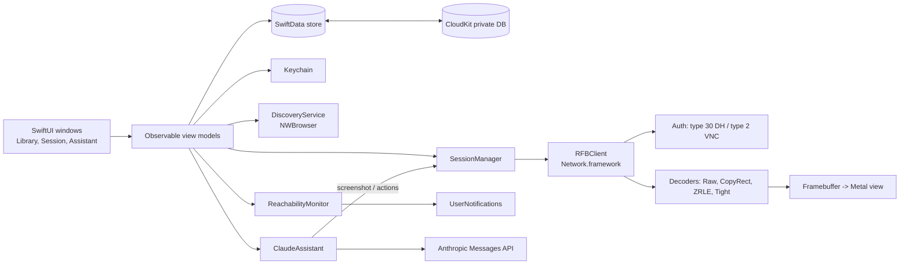

# TRD — RemoteDeck

## Platforms

- macOS 15 Sequoia and later, Apple Silicon and Intel (universal binary). *(assumption)*
- Built with the stable Xcode release (never a beta), Swift 6 language mode.

## Frontend and hosting

- **UI:** SwiftUI for windows, sidebar, sheets and settings; AppKit (`NSView` subclass backed by a `CAMetalLayer`) for the remote framebuffer view, because it needs precise key, mouse, scroll-wheel and modifier handling that SwiftUI does not expose.
- **App type:** regular windowed app plus a `MenuBarExtra` for quick connect.
- **Distribution:** Developer ID-signed, notarized DMG in `release/`, Sparkle auto-updates (see the `macos-app-release` skill). *(assumption)*
- **No hosted component.**

## Backend and database

- **No server.**
- **Local store:** SwiftData (SQLite) in the app container.
- **Sync:** SwiftData's CloudKit integration, private database of Vincent's iCloud account (container `iCloud.<bundle-id>`). Only the Machine Library is synced: Machine and MachineGroup. Session History, Assistant Actions and settings stay local.
- **Secrets:** macOS Keychain. Machine passwords are synchronizable items (iCloud Keychain); the Anthropic API key is a local-only item.

## Authentication and roles

No app accounts and no roles: single local user (see PRD). Remote authentication is per machine:
- **ARD / macOS Screen Sharing:** RFB security type 30 (Apple Diffie-Hellman, macOS user name + password).
- **VNC:** security type 2 (VNC password) and type 1 (none), for Anthropic VMs and generic VNC servers.
- **Anthropic API:** API key entered in Settings Window, stored in Keychain.

## External services and APIs

| Provider | Usage | Limits / quotas | Credential owner |
|---|---|---|---|
| Remote Macs (RFB/ARD, TCP 5900) | Screen Session | LAN or VPN only | Vincent (macOS accounts on each Mac) |
| Anthropic computer use environments (VNC, TCP 5900 by default) | Anthropic VM Connect | Reachable endpoint required (local Docker or tunnel) | Vincent |
| Anthropic Messages API (computer use tool) | Claude Assistant | Per-account rate limits and token billing; screenshots ≈ 1–2k tokens each *(assumption)* | Vincent (API key) |
| Apple CloudKit (private DB) | iCloud Sync | Free private-database quota, counted against Vincent's iCloud storage | Vincent (iCloud account) |
| Apple Bonjour (`_rfb._tcp`, `_net-assistant._udp`) | Bonjour Discovery | LAN multicast only | — |
| macOS User Notifications | Status Notifications | — | — |
| Sparkle appcast (GitHub Releases) | Updates | — | Vincent |

## Architecture

- **RFBClient** is a Swift package target (`RFBKit`) with no UI dependency, so it can be unit-tested against recorded byte streams.
- Each session runs its socket and decoding on its own actor; frames go to the main actor only as dirty rectangles for the Metal texture.
- **ClaudeAssistant** turns API `tool_use` actions (click, type, key, scroll) into RFB pointer and key events, but only after the user confirms each one.

## Security and privacy

- **Sensitive data:** machine passwords, the Anthropic API key, and remote screen contents. Passwords and the API key stay in the Keychain only; they are never stored in SwiftData, logs or CloudKit.
- **Transport:** RFB is not encrypted beyond the ARD credential exchange, so connections are restricted to LAN or VPN. Show a warning badge when the host is a public IP. *(assumption)*
- **Screenshots** are sent to Anthropic only on explicit Claude Assistant requests; a header indicator shows when a request is in flight.
- **Retention:** Session History is kept 365 days, then purged *(assumption)*. Assistant Actions are kept 30 days *(assumption)*. Screenshots are never written to disk.
- **App Sandbox** on, with the `network.client` entitlement. Hardened runtime on for notarization.

## Performance and reliability targets

- Time from click to first frame: ≤ 5 s on LAN (p90), ≤ 1.5 s typical.
- Added local input latency (event → bytes sent): ≤ 50 ms.
- Render at the display refresh rate (up to 120 Hz) for dirty regions; CPU ≤ 25 % of one core for a 1080p static desktop.
- Bonjour results within 3 s.
- Reachability probe: TCP connect to port 5900 every 60 s per watched machine; offline after 2 consecutive failures.
- Backups: the SwiftData store is covered by Time Machine; CloudKit acts as a second copy of the Machine Library.

## Environments and release

- **Environments:** development (Xcode Debug, separate bundle id `.dev` and CloudKit development environment) and production (Release, CloudKit production). No staging: solo tool.
- **Test hosts:** one local Mac with Remote Management enabled, plus the Anthropic computer use reference container running locally in Docker.
- **CI:** GitHub Actions on `macos-latest` running `xcodebuild test` for `RFBKit` and the app.
- **Release:** `Scripts/release.sh` → signed, notarized and stapled DMG in `release/` → `appcast.xml` → GitHub Release.

## Key technical decisions and trade-offs

| Choice | Reason | Alternative considered |
|---|---|---|
| Pure-Swift RFB client | No GPL constraint, full control of ARD auth and Metal rendering, testable | libvncclient (GPL-2.0, C bridging) |
| Network.framework (`NWConnection`) | Modern async I/O, Bonjour integration, TLS later if needed | BSD sockets / SwiftNIO |
| Metal-backed AppKit view | Smooth scaling and high refresh rate | SwiftUI `Canvas` / `CGImage` (too slow for full-screen updates) |
| SwiftData + CloudKit | Free sync, little code, matches iCloud Sync | Custom JSON file + iCloud Drive; CKSyncEngine (more control, more code) |
| Keychain for every secret | macOS standard, syncs via iCloud Keychain | Encrypted field in SwiftData |
| On-demand Claude Assistant with per-action confirmation | Cost control and safety on real machines | Autonomous agent loop |
| DMG + Sparkle | Same pipeline as Vincent's other apps, no App Review | Mac App Store |
